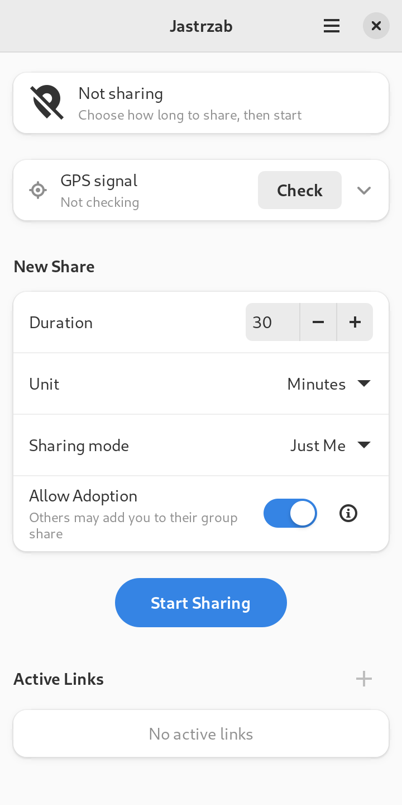
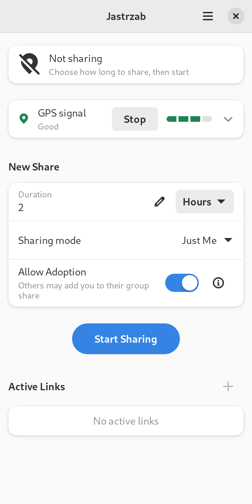
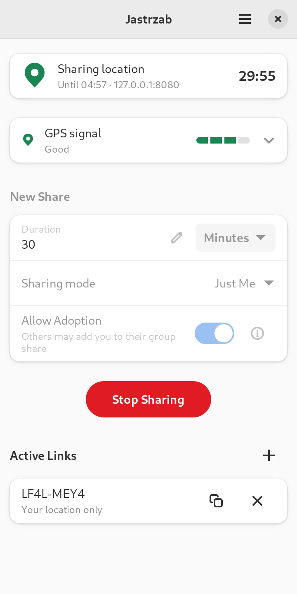
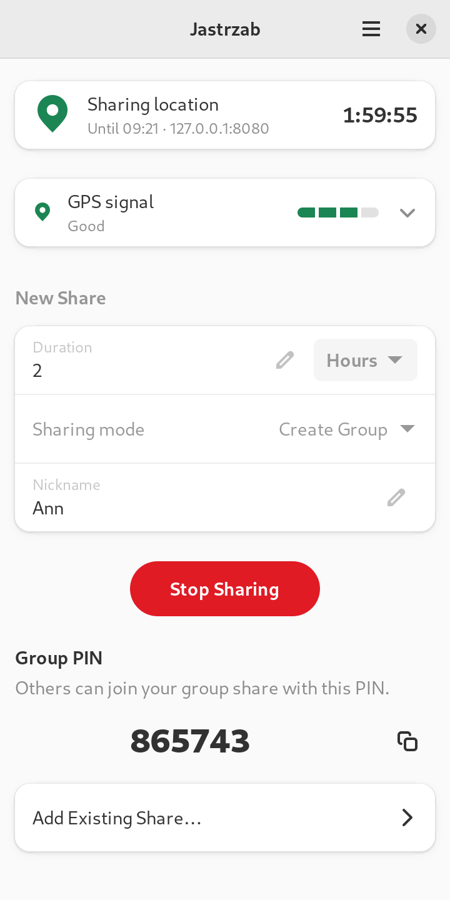

# Jastrzab

Share your live location with a link, using your own [Hauk](https://github.com/bilde2910/Hauk)
server. Jastrzab is a Hauk client for **mobile Linux** (Phosh on the Librem 5, PureOS Crimson),
also usable on a desktop. It speaks Hauk's protocol, so the Hauk server and its web viewer work
unchanged, and people following your link need no app.

<p align="center">
  
  
  
  
</p>

*Screenshots of the real app at 360×720, from a headless Phoc on PureOS Crimson's libraries.*

It does what the Hauk Android app does, and one thing it does not: it tells you **whether the
phone has a GPS fix and how good it is**, before you start sharing and while you do, in words
rather than a satellite count (see [the design](docs/phosh-gui-design.md), §4.4).

## What it does

* **Share for a time you choose**, as just you, or as a group: create one and hand out its PIN,
  join one, or add somebody's existing share to yours ("adoption"). Several links per share.
* **GPS signal indicator**: *Searching*, *Poor*, *Fair*, *Good*, *Excellent* or *Signal lost*, with
  what it means for the people watching and what to try. *Check* it before you share.
* **End-to-end encryption** (optional): the server stores only ciphertext; viewers enter the
  password. The same PBKDF2/AES scheme as the Android app and the web viewer.
* **Stays on while the window is closed**: the notification has *Copy Link* and *Stop Sharing*
  (the latter also on the lock screen), and a suspend inhibitor keeps the phone awake while
  sharing.
* **Saves battery without a network**: it follows NetworkManager. Posting stops at once; after 20
  seconds without a network the GPS is switched off too (the signal row says *Paused*), and it comes
  back with the network. The phone is still kept awake while a share runs. (*Pause When Offline* in
  Preferences turns this off, for a server on a network the system counts as offline, such as a
  LAN without a gateway.)
* **Resumes** a share after the app was killed.
* **Proxies** (system, HTTP, SOCKS), a connection timeout, and Hauk's relaxed certificate checks for
  `.onion` servers.
* **Fits a phone**: the window never grows past the screen, whatever a server sends; it works in
  portrait and landscape, at large text sizes, in dark mode and high contrast.

## Installing

Every release has a `.deb`, an AppImage and a Flatpak, for **arm64** (the Librem 5) and **amd64**.
The APT and Flatpak repositories below are signed and contain the latest release; all three
packages are also on the [releases page](https://github.com/gdr-aislop/jastrzab/releases). Once
installed, open Jastrzab, choose *Preferences* from the menu, and enter your server's address and
password.

### APT (PureOS Crimson, Debian 12, Ubuntu 24.04)

```sh
sudo curl -fsSLo /usr/share/keyrings/jastrzab.asc https://gdr-aislop.github.io/jastrzab/apt/jastrzab.asc
echo "deb [signed-by=/usr/share/keyrings/jastrzab.asc] https://gdr-aislop.github.io/jastrzab/apt stable main" \
    | sudo tee /etc/apt/sources.list.d/jastrzab.list
sudo tee /etc/apt/preferences.d/jastrzab.pref <<'EOF'
Package: jastrzab
Pin: release o=jastrzab
Pin-Priority: 500

Package: *
Pin: release o=jastrzab
Pin-Priority: -1
EOF
sudo apt update
sudo apt install jastrzab
```

The `preferences.d` file limits this repository to the one package: APT trusts the signing key for
every package name the repository lists, so without the pin a repository that ever carried, say, a
different `libc6` could replace the system's. With it, anything but `jastrzab` from this source has
no installation candidate. (Check with `apt-cache policy <package>`.)

`sudo apt upgrade` then keeps Jastrzab current. Without the repository, install the downloaded file
instead: `sudo apt install ./jastrzab_*_arm64.deb` (or `_amd64.deb`).

### Flatpak

```sh
flatpak remote-add --user --if-not-exists jastrzab https://gdr-aislop.github.io/jastrzab/io.github.gdr_aislop.jastrzab.flatpakrepo
flatpak install --user jastrzab io.github.gdr_aislop.jastrzab
flatpak run io.github.gdr_aislop.jastrzab
```

The remote file also names Flathub as the source of the GNOME runtime, so this works on a phone
that has not added Flathub. What differs inside the sandbox:

* **No crash dumps.** The crash handler needs `ptrace`, which the sandbox's seccomp filter blocks,
  so a crash leaves a log but no minidump.
* **Logs** are in `~/.var/app/io.github.gdr_aislop.jastrzab/.local/state/io.github.gdr_aislop.jastrzab/logs/`.
  *Open Log Folder* in Preferences may not open a file manager from the sandbox; it then shows
  that path.
* **The password** is kept through the Secret portal, which needs a keyring behind it (Phosh
  has gnome-keyring).
* The app talks to GeoClue and logind on the system bus directly (the manifest's
  `--system-talk-name` entries).

### AppImage

Download `jastrzab-<version>-aarch64.AppImage` (or `x86_64`), then:

```sh
chmod +x jastrzab-*.AppImage
./jastrzab-*.AppImage
```

It bundles GTK, libadwaita, libsoup and libsecret, so it needs nothing installed. **Install it
into the application menu** (Gear Lever and AppImageLauncher do) rather than only running the
file: GeoClue decides whether an app may see the location from its `.desktop` file, so without
one it can refuse. The `.zsync` file next to it lets AppImageUpdate and Gear Lever update it.

### Checking a download

Each `.deb` and `.AppImage` has a detached signature (`.asc`) made with the release key, which is
also `jastrzab-signing-key.asc` on the release and `jastrzab.asc` in the APT repository:

```sh
gpg --import jastrzab-signing-key.asc
gpg --verify jastrzab_0.1.0-1_arm64.deb.asc jastrzab_0.1.0-1_arm64.deb
sha256sum --check --ignore-missing SHA256SUMS
```

The key's fingerprint is in [docs/releasing.md](docs/releasing.md). To build from source, see
[BUILD.md](BUILD.md).

## Using it

1. In *Preferences*, set the **server address** and **password** (kept in the Secret Service,
   not in a file).
2. Optionally press **Check** to see the GPS signal. It stops by itself after 5 minutes, or when
   you leave the app.
3. Choose a duration and **Start Sharing**. **Copy Link** in the toast, or any row under
   *Active Links*, gives you the link to send.
4. **Stop Sharing** from the app or the notification.

The first time, Phosh asks whether Jastrzab may use your location.

## Where things are

Same layout as the author's other Phosh app, [audiobooklet](https://github.com/gdr-aislop/audiobooklet):

| What | Where |
|---|---|
| Settings | `~/.config/io.github.gdr_aislop.jastrzab/settings.toml` |
| Unfinished share (to resume) | `~/.local/state/io.github.gdr_aislop.jastrzab/session.toml` (mode 0600; holds the derived encryption key when end-to-end encryption is on; deleted when the share ends) |
| Log files | `~/.local/state/io.github.gdr_aislop.jastrzab/logs/jastrzab.YYYY-MM-DD` |
| Crash dumps | `~/.local/state/io.github.gdr_aislop.jastrzab/crashes/crash-<unix time>-<pid>.dmp` |
| Passwords | Secret Service (gnome-keyring), keyed by server |

**Logs** are plain text, rotate daily and keep seven files, and are held in memory and written
out once a minute (and on exit and on a panic), so the app does not touch flash on every event:

```
2026-10-22T08:15:30.123456Z  INFO jastrzab: starting up version=Jastrzab 0.1.0 (a1b2c3d) os="linux" arch="aarch64" ...
```

`RUST_LOG=debug` raises the level. The server address, user name, share IDs and group PIN are
replaced with `<server>`, `<user>` and `<id>` (Preferences → Diagnostics → *Anonymize Logs*, on by
default). Coordinates and passwords are never logged at all. *Open Log Folder* is in Preferences.

**Crashes** (a segfault in GTK or a library, which a Rust panic handler cannot catch) write a
Breakpad minidump to `crashes/`, and a line saying so, with the dump's name, to the log, preceded
by the lines that were still in the buffer. Read a dump with
[`minidump-stackwalk`](https://crates.io/crates/minidump-stackwalk). Nothing is ever sent
anywhere.

## How it is built

A Rust workspace in three layers; dependencies point inward only.

```
app/                   GTK 4 + libadwaita UI, the platform adapters, the controller
crates/jastrzab-core/  sans-IO: the sharing engine, request batching, GPS signal model, settings
crates/hauk/           sans-IO: Hauk's wire protocol and end-to-end encryption
```

The **engine** is a state machine: `handle(event, now) -> effects`. It never reads a clock, opens a
socket or touches a widget, so every rule about sessions, batching and the GPS signal is tested
without a phone (100 tests). The app's **controller** feeds it one event at a time from a single
queue and carries out the effects through GDBus (GeoClue, logind, notifications), libsoup 3 and
libsecret, which run on the GLib main loop: no extra threads and no async runtime.

Built for a phone's battery and flash:

* Location runs only while sharing or while *Check* is on. GeoClue is told the update interval, so
  the process is not woken for positions it would drop.
* At most one request is in flight. A new position replaces one still waiting, so a slow network
  never builds a backlog; failures back off 2, 4, 8 … 60 s and a returning network retries at once.
  One HTTP session is reused, so keep-alive saves a TLS handshake per post.
* Nothing polls. The link list rides along with each post's reply; timers are whole-second GLib
  timers; the countdown ticks only while the window is in front.
* Files are written once after a burst of changes, atomically. The resume file is written only
  when the links change, never per position, and no location history is kept.

The design, with the research behind it (how Phosh sizes windows, what GeoClue can and cannot
tell an app, accessibility), is in [`docs/phosh-gui-design.md`](docs/phosh-gui-design.md) and
[`docs/hauk-report.md`](docs/hauk-report.md).

## Testing

```sh
cargo test --workspace                                   # 167 tests, no display needed
```

Protocol tests against a real Hauk backend, end-to-end encryption checked against Node's WebCrypto,
and a headless Phoc harness that runs the real app on PureOS Crimson's libraries are described in
[`scripts/ui-e2e/`](scripts/ui-e2e/README.md).

## License

GPL-3.0-or-later (see [LICENSE](LICENSE)). The wire protocol and the idea come from Hauk by Marius
Lindvall (Apache-2.0), credited in the About window.
The UI's symbolic icons in `app/data/ui-icons` are from the Adwaita icon theme (LGPL-3.0-or-later
or CC-BY-SA-3.0); see the README there.
