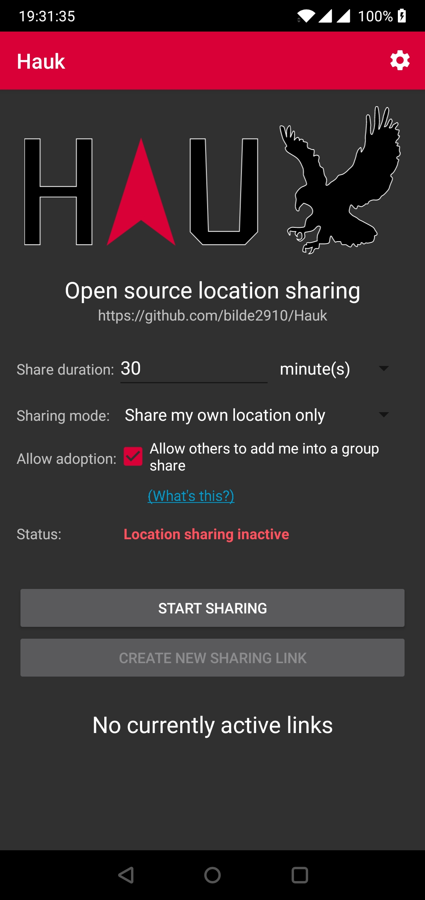
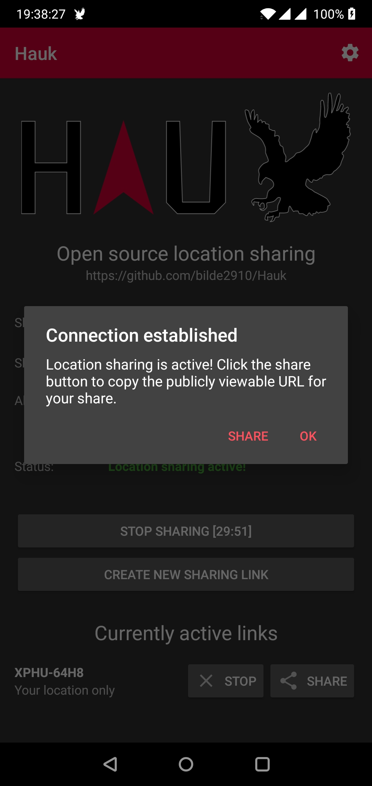
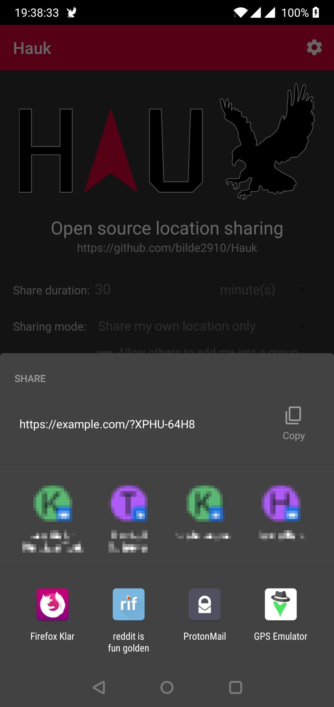
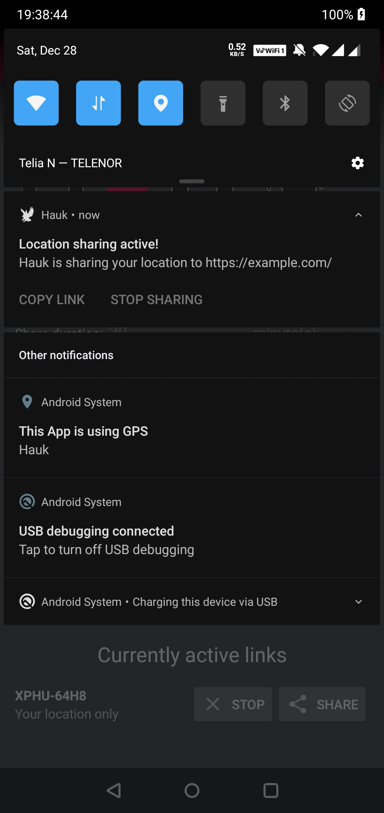
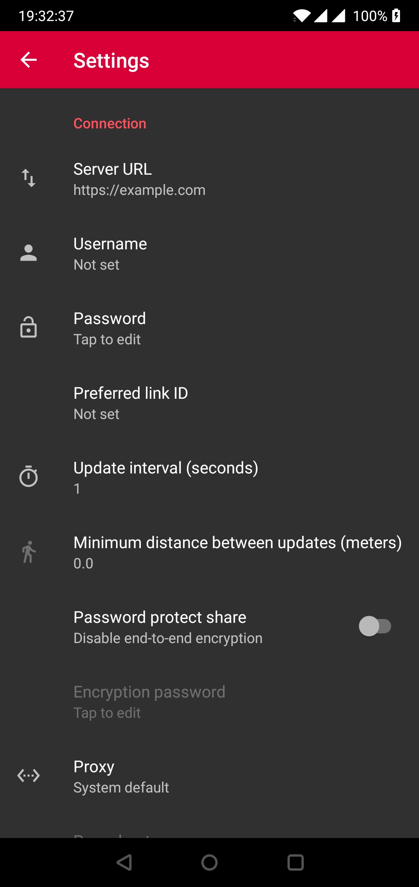

# Hauk — how it works and what it looks like

Report prepared as input for a port of the Hauk Android app to another platform.

- Source: https://github.com/bilde2910/Hauk, checked out at `b05c40f` (app v1.6.3, build 15).
- Store listing: https://f-droid.org/en/packages/info.varden.hauk/. The five screenshots on that page are the same files as `fastlane/metadata/android/en-US/images/phoneScreenshots/`. They are copied to [`docs/hauk-screenshots/`](hauk-screenshots/).
- License: Apache 2.0, so code and assets can be reused with attribution.

---

## 1. What Hauk is

Hauk is **self-hosted, real-time location sharing**. A user installs the backend on their own server. The phone app then streams its GPS position to that server for a fixed length of time. The server gives the user a **share link**. Anyone who opens the link in a browser sees a live map with the user's position until the share expires or is stopped.

It has three parts:

| Part | Tech | Role | Path in repo |
|---|---|---|---|
| **Android app** | Java, AppCompat, ~9.2k LOC, minSdk 24, target SDK 36 | The sender. Collects GPS and pushes it to the server. This is the part being cloned. | `android/` |
| **Backend** | PHP and Memcached or Redis | Authenticates the sender, stores recent points in a cache for a limited time, and serves them to viewers. | `backend-php/` |
| **Web viewer** | Static HTML/JS, Leaflet 1.6 | The recipient's map page, opened from the link. | `frontend/` |

The app is the only part that **sends** location. Viewers need no app, only a browser.

**Design properties worth preserving in a port**

- No account system or central service. The user types in their own server URL.
- There is no database, only a cache. Points expire when the share ends.
- Privacy by obscurity: a share link is the only access control for viewing. The format is configurable, and the default is `XXXX-XXXX` (4 plus 4 uppercase characters).
- Optional end-to-end encryption, so the server only stores ciphertext. The viewer prompts for a password and decrypts in the browser.
- The client and server negotiate features by version (`X-Hauk-Version` header) and degrade gracefully.

---

## 2. User-visible flows (Android app)

There are only **two screens** (main and settings), plus dialogs, a notification, and an invisible broadcast-intent entry point.

### 2.1 Screenshots

| # | Screenshot | What it shows |
|---|---|---|
| 1 |  | **Main screen, idle.** Red toolbar with the title "Hauk" and a settings gear. Large HAUK logo. Tagline and repo URL. The share form. Start and Create-link buttons. Empty links list. |
| 2 |  | **Sharing active.** The "Connection established" dialog with **Share** and **OK**. Behind it the form is locked, the status is green, the button reads `STOP SHARING [29:51]`, and one link row (`XPHU-64H8`, "Your location only") has **Stop** and **Share** buttons. |
| 3 |  | **System share sheet** with the view URL (`https://example.com/?XPHU-64H8`) and the OS Copy action. |
| 4 |  | **Ongoing notification** "Location sharing active! — Hauk is sharing your location to https://example.com/", with actions **Copy link** and **Stop sharing**. |
| 5 |  | **Settings.** A standard Android preference list under the heading "Connection", with a back arrow in the toolbar. |

### 2.2 Main screen (`ui/MainActivity`, `res/layout/activity_main.xml`)

Top to bottom, in a vertical `ScrollView` with 16 dp padding:

1. **Toolbar.** The title is "Hauk", the background is `#D80037` (the brand red), and there is one menu item, the **settings gear**.
2. **Logo** (143 dp tall). It can be hidden in settings. Tapping it opens the GitHub page.
3. **Heading** "Open source location sharing" and the repo URL. Tapping either opens GitHub.
4. **Form.** A label column on the left and a control column on the right.
   - **Share duration:** a number field (default 30) plus a unit spinner (`minute(s)`, `hour(s)`, `day(s)`).
   - **Sharing mode:** a spinner with three options: *Share my own location only*, *Create a group share*, *Join a group share*.
   - **Allow adoption:** a checkbox "Allow others to add me into a group share", plus a blue underlined **(What's this?)** link that opens an explanation dialog. This row is only shown in "own location only" mode.
   - **Nickname:** a text field, shown only for group create or join.
   - **Group PIN:** a 6-digit numeric field, shown only when joining a group.
   - **Status:** a bold coloured label (see the table below).
5. **Group PIN panel**, shown only after a group is created. It shows "YOUR GROUP PIN:", the PIN in 55 sp bold, help text, and a **Merge an existing sharing link** button (adoption).
6. **START SHARING** button. While sharing it becomes **STOP SHARING [mm:ss]**, a live countdown to expiry.
7. **CREATE NEW SHARING LINK** button. It is disabled until a session exists, and also if the backend is older than v1.2.
8. **Links list** with a heading that switches between "No currently active links" and "Currently active links". Each row has a bold link ID, a subtitle (*Your location only*, *Group share (host)* or *Group share (member)*), and **Stop** and **Share** buttons. Stop removes just that link. Share opens the system share sheet, with the subject "Follow my location on Hauk!".

**Status label values** (`labelStatusCur`; colours in `res/values/colors.xml`):

| Text | Colour | Meaning |
|---|---|---|
| Location sharing inactive | red `#D80037` | idle |
| Waiting for initial GNSS fix… | orange `#FF9C00` | session created, no fix yet |
| Waiting for high accuracy fix… | orange | only a coarse (network) fix so far |
| Searching for location… | orange | GPS fix lost, falling back to network |
| Location sharing active! | green `#007F00` | good GPS fix, posting |
| Unable to reach backend server | dark red `#76001E` | the last post failed |

**While a session is active**, the form fields (duration, unit, mode, nickname, PIN, adoption) are disabled. Only the Stop button, the New-link button, the per-link buttons and the group panel stay usable.

**Persisted form state.** Duration, unit, nickname and adoption are saved on every start. They are restored on launch.

### 2.3 Sharing modes

| Mode | What happens |
|---|---|
| **Own location only** (`CREATE_ALONE`) | A private single-user share and one link. The adoption flag says whether someone else may later absorb this share into their group. |
| **Create a group share** (`CREATE_GROUP`) | The server returns a 6-digit **group PIN** (100000–999999) and a link. The app shows the PIN so friends can join. The host can **adopt** other people's existing solo shares into the group, by pasting the link or ID and giving them a nickname. |
| **Join a group share** (`JOIN_GROUP`) | The user enters the PIN and a nickname. The server adds this session to the group, and the group link is shown. |

A nickname is mandatory for both group modes. Adoption needs no interaction from the adopted person, which suits the driving use case. Adoption is refused for end-to-end-encrypted shares. End-to-end encryption is also not supported for group shares at all.

### 2.4 Dialogs and messages

All are plain `AlertDialog`s through `dialog/DialogService`:

- **Connecting** (spinner `ProgressDialog`, not cancellable): "Connecting to Hauk…". It also shows "Resolving proxy hostname…".
- **Connection established**: "Location sharing is active! Click the share button to copy the publicly viewable URL for your share." Buttons are **Share** and **OK**. Shown only when the user started the share. Relaunches and resumes are silent.
- **Create new sharing link** dialog: an adoption checkbox with the "What's this?" link, then a progress dialog "Creating new sharing link…", then a "Link created" confirmation.
- **Adopt another user's session**: a dialog with a "Share ID/URL" field and a nickname field. The ID is extracted from a pasted URL with the regex `\?([A-Za-z0-9-]+)`. Success shows "<nickname> has been added to your share!".
- **Stop sharing?** confirmation, with Yes, No and **Don't show again**. It can be turned off in settings. A similar one confirms deleting a single link.
- **Share adoption** explainer, which is a long text.
- **Resume session**: shown at launch if a still-valid session was saved. It says "You have an unfinished session: Active sharing link(s): N, Expires: <date>. Do you wish to resume?" The choices are Yes and No.
- **Permission required**: a rationale shown before the OS location permission prompt. The user must tap Start again afterwards.
- **Aggressive battery savings**: a one-time warning on Huawei, OnePlus and Xiaomi devices, with an "Open settings" button.
- **Error dialogs** for: invalid duration; no nickname; no server configured (this one is a toast and then jumps to Settings); location services disabled; missing permission; server error text; HTTP code errors; empty response; and "Server is out of date" when group mode or E2E is not supported (the app downgrades the share and says so).

### 2.5 Settings (`system/preferences/ui/SettingsActivity`, `res/xml/root_preferences.xml`)

A standard AndroidX `PreferenceScreen` with three categories. Key, default and validation are in `Constants.java`. Server URL, username, password and E2E password are stored **encrypted** with the Android Keystore (`system/security/`). The other settings are plain.

**Connection**

| Setting | Key | Default | Notes |
|---|---|---|---|
| Server URL | `cryptServer` | empty | A trailing `/` is appended. The hint is `https://example.com/`. |
| Username | `cryptUsername` | empty | Optional. Only used by htpasswd or LDAP backends. |
| Password | `cryptPassword` | empty | Shown as "Tap to edit". |
| Preferred link ID | `requestLink` | empty | Requests a custom link name. The server may refuse it or reserve it. |
| Update interval (s) | `interval` | 1 | Integer ≥ 1. |
| Min. distance between updates (m) | `minUpdateDistance` | 0.0 | Float ≥ 0. |
| Password protect share | `enableE2E` | off | A switch. Enables end-to-end encryption. |
| Encryption password | `e2ePassword` | empty | Only enabled when the switch is on. |
| Proxy | `proxyType` | System default | The choices are System default, Do not proxy, HTTP, and SOCKS 4/5. |
| Proxy hostname / port | `proxyHost` / `proxyPort` | `localhost` / 9050 | Only enabled for HTTP or SOCKS. The port is 0–65536. |
| Connection timeout (s) | `connectTimeout` | 10 | Integer ≥ 1. |
| Fall back to network location if GNSS is unavailable for (s) | `noGnssFallback` | 45 | |
| HTTPS certificate validation | `tlsCertValidation` | Always validate | Two weaker choices apply only to `.onion` hosts (Tor). |

**Appearance**

| Setting | Key | Default |
|---|---|---|
| Night mode | `nightMode` | Follow system (the choices are Follow system, When battery saver is enabled, Always, Never) |
| Confirm before stopping shares | `confirmStop` | on |
| Hide logo on main screen | `hideLogo` | off |

**About Hauk**: app version (read-only), source code (opens GitHub), report an issue (opens the GitHub new-issue page).

### 2.6 The notification (`notify/SharingNotification`)

- It is an **ongoing, foreground-service** notification. The small icon is the eagle.
- The title mirrors the status label (see the status table above). The body is "Hauk is sharing your location to <server URL>".
- It has two actions: **Copy link** (copies the view URL and shows "Copied link from Hauk") and **Stop sharing**.
- Tapping the notification reopens the main activity.

### 2.7 Automation entry point (`global/Receiver`, `AuthorizationActivity`)

Third-party apps such as Tasker can start a share by sending broadcast intents.

- The actions are `info.varden.hauk.START_ALONE_THEN_SHARE_VIA` (it opens the share sheet) and `info.varden.hauk.START_ALONE_THEN_MAKE_TOAST` (it needs a custom ID, and shows a toast with the link).
- Extras (all optional apart from `source`): `source` (a caller identifier, required), `duration`, `interval`, `minDistance`, `requestLink`, `adoptable`. Anything missing falls back to the saved settings.
- **Authorisation.** The first time an unknown `source` calls in, the broadcast is blocked and a small "Broadcast authorization request" activity appears. It asks "Do you wish to allow sessions to be created from broadcasts with this identification in the future?" with **Yes** and **No**. The answer is remembered per source. A denied source is silently ignored.

### 2.8 Other behaviour

- **Session resume.** The session and its shares are serialised to preferences. After the app is killed, the next launch offers to resume, or silently relaunches if the foreground service is still running. It is only valid for the same app version, and the session must not have expired.
- **Locale.** English plus 14 translations are shipped (ca, de, es, eu, fr, it, nb-NO, nl, nn, pl, ro, ru, tr, uk).
- **Orientation.** The main activity is locked to portrait.
- **Edge-to-edge.** The root view is padded by system-bar insets (an Android 16 fix).
- **Permissions requested** (see `AndroidManifest.xml`): fine and coarse location (foreground only), foreground service, foreground service type `location`, internet, and post notifications. There is **no background-location permission**. Tracking relies on the foreground service.

---

## 3. How it works internally

### 3.1 Lifecycle of a share

```
User taps START
 │  validate duration, nickname, server URL; save form prefs
 ├─ check location permission  → (rationale dialog → OS prompt → user taps START again)
 ├─ check GPS provider enabled → error dialog if not
 ├─ resolve proxy hostname if a proxy is configured (async)
 └─ POST api/create.php  ──►  "OK / sessionID / viewURL / [groupPIN] / linkID"
        │   reads X-Hauk-Version, may downgrade mode or drop E2E
        ▼
 Session + Share objects created, saved for resume
 └─ start LocationPushService (foreground, type=location)
      ├─ GPS_PROVIDER updates (interval ms, 0 m)       → "fine"
      ├─ NETWORK_PROVIDER updates (interval, minDist)  → "coarse", until a GPS fix arrives
      │     └─ if no GPS fix for interval + noGnssFallback seconds → re-register NETWORK
      └─ every fix → POST api/post.php (sid, lat, lon, time, prv, [spd], [acc])
             ◄── "OK / linkFormat / comma-separated active link IDs"
                    └─ reconcile local link list with the server's (adds or removes rows)
 Handler.postDelayed(stopTask, remaining)  ── expiry timer
 Main-thread 1 s ticker                    ── countdown in button text
User taps STOP / expiry fires
 └─ POST api/stop.php (sid [, lid])  → stop service, clear resume data, reset UI
```

Notes for a port:

- **Fine and coarse providers.** GPS reports are tagged `prv=0` (fine) or `prv=1` (coarse). In the web viewer they appear as red (live) and orange (rough) markers. The app starts on the network provider and removes it as soon as GPS reports.
- **Min-distance filter.** It is applied **client-side to GPS only**. The OS request always uses distance 0, so the no-GPS-fix timer keeps working. The server never gets a point closer than `minDistance` to the last one sent.
- **Connection state.** The first failed post flips the status to "Unable to reach backend server". The next successful post restores the previous status. Failures do not stop the share.
- **Server-driven link list.** Each post response contains the full list of active link IDs. The app uses it to discover links added elsewhere (for example by adoption) and to drop links the server ended.
- **Foreground service** is `START_NOT_STICKY`. The stop action is passed through a static in-process registry (`ReceiverDataRegistry`) rather than being serialisable.
- **Time and clock.** Timestamps are the **device clock** at send time, as seconds with a fractional part (`System.currentTimeMillis() / 1000.0`), not the GPS fix time.

### 3.2 Wire protocol

All calls are `POST` with `application/x-www-form-urlencoded` to `<server>/api/<name>.php`. The response is HTTP 200 plain text, one datum per line. **Line 1 is `OK`** on success. On failure line 1 is a localised error message, and the app shows the whole body in an error dialog. Any non-200 code is an error ("Received HTTP %s from server!"). Every response carries an `X-Hauk-Version: x.y.z` header.

The request also sends `Accept-Language` and a `User-Agent` of the form `Hauk/<version> <http.agent>`.

| Endpoint | Request params | Response lines (after `OK`) |
|---|---|---|
| `create.php` (start session) | `dur` (seconds), `int` (seconds), `pwd`, `usr?`, `lid?` (custom link), `mod` (0 alone / 1 create group / 2 join group), `ado` (0/1; solo only), `nic` (group modes), `pin` (join), `e2e` (0/1), `salt` (E2E, base64) | `sid`, `viewURL`, then `groupPIN` (create group only), then `linkID` (v1.2+) |
| `post.php` (location) | `sid`, `lat`, `lon`, `time`, `prv` (0 fine / 1 coarse), `spd?` (m/s), `acc?` (m), `iv` (E2E only) | `linkFormat` (`https://host/?%s`), CSV of active link IDs |
| `new-link.php` | `sid`, `ado` | `viewURL`, `linkID` |
| `adopt.php` | `sid`, `nic`, `aid` (the solo share's ID), `pin` | none |
| `stop.php` | `sid`, optional `lid` (one link only; omitted means end the whole session) | none |
| `fetch.php` (viewers only, GET) | `id`, `since?` | JSON, see §4 |

**Server-side constraints** (`backend-php/include/config-sample.php` and `api/create.php`):

- `max_duration` is 86400 s (24 h). A request for a longer share is rejected.
- `min_interval` is 1 s.
- Link style is configurable and defaults to `XXXX-XXXX` upper case. The alternatives are lower or mixed case, UUIDv4, and 16 or 32 characters of hex or letters.
- The custom link ID must match `^[\w-]+$`. Admins can reserve IDs per user (`reserved_links`).
- Authentication is one of: a single bcrypt **password** (default), an **htpasswd** file with username and password, or **LDAP**.

**Version gates** (`Constants.java`): group shares need v1.1, the link-ID reply needs v1.2, and E2E needs v1.5. The current backend is 1.6.3.

### 3.3 End-to-end encryption (optional)

- The user sets an "Encryption password" in settings.
- On session start the client generates a **32-byte random salt** and sends it as `salt`.
- The key is derived with **PBKDF2WithHmacSHA1**, 65536 iterations, to an **AES-256** key. The cipher is **AES/CBC/PKCS5Padding**.
- Each location post generates a random IV. `lat`, `lon`, `prv`, `time`, and `spd` and `acc` if present, are each AES-encrypted and base64-encoded. `iv` is sent in the clear.
- The server stores the ciphertext without any validation. The viewer asks for the password, derives the same key from the stored salt using WebCrypto (`crypto.subtle`, so HTTPS is required), and decrypts in the page.
- Not available for group shares. Adoption of an encrypted share is refused.

A port needs PBKDF2-SHA1, AES-256-CBC and base64. The SHA1 parameter is easy to get wrong because the web viewer must interoperate.

### 3.4 Networking details

- `ConnectionThread` uses `HttpURLConnection` on `AsyncTask`. That is deprecated, and a port should use its platform's normal HTTP client.
- It supports **HTTP and SOCKS proxies** and a system default. For proxies it resolves the hostname first, with a "Resolving proxy hostname…" progress step.
- **TLS.** Certificates are validated by default. A policy can disable trust-anchor checks, or trust anchor and hostname checks, but only for `.onion` hosts. This exists to support Tor.
- The connect timeout is configurable. There is no read timeout or retry. A lost post is simply replaced by the next one.

### 3.5 Android-specific mechanisms to replace

| Android mechanism | Purpose | Port equivalent to find |
|---|---|---|
| Foreground service with `location` type, plus an ongoing notification | Keep sampling while the app is backgrounded. | Background location mode (iOS), or a foreground or long-running task. |
| `LocationManager` with `GPS_PROVIDER` and `NETWORK_PROVIDER` | Two quality tiers and fallback. | The platform's fused or high-accuracy and low-power location modes. |
| Android Keystore plus SharedPreferences | Encrypted settings. | Keychain or equivalent. |
| `BroadcastReceiver` with an authorisation prompt | Automation hook. | URL scheme, App Intents or Shortcuts, or an equivalent. Optional. |
| `DeviceChecker` (Huawei, OnePlus, Xiaomi) | Battery-saver warning. | Only if the target platform has the same problem. |
| System share sheet | Send link. | The platform's share sheet. |
| AppCompat night mode | Theming. | The platform's dark mode. |

---

## 4. Web viewer (what the recipient sees)

This is not the app being cloned, but the app UI refers to it, and a port must stay compatible with it unless it also replaces the viewer.

**URL forms**

- `https://server/` shows an index page with the logo and "point the app to <this URL>", plus F-Droid and Google Play badges.
- `https://server/?XXXX-XXXX` shows the live map for that link. An expired or unknown link gives the "share expired / not found" cover page.

**Map page**

- A full-screen **Leaflet** map using the server-configured tile URL (OpenStreetMap by default). The default zoom is 14.
- A **notch** at the top centre, which is a countdown (`h:mm:ss`) until expiry. It switches to "Offline" when updates stop.
- A **Hauk logo** in a bottom corner, linking to GitHub.
- **Controls:** "show my location" (the viewer's own blue dot and accuracy circle, with three states: inactive, pending, active) and a "radar" button that opens the user list (group shares).
- **Marker** per sender: an arrow icon that rotates to the direction of travel. There are six states: *still* or *moving*, each as *live* (red `#d80037`), *rough* (orange `#ff9c00`) or *dead* (grey `#555`).
  - A label under the marker shows the nickname (group shares only), speed in the configured unit, and "last seen X ago" once the point is stale.
  - A marker turns grey ("dead") after `offline_timeout` (30 s) without a new point.
  - A translucent **accuracy circle** surrounds the marker, coloured like the marker.
  - A trail is drawn as a polyline in the configured colour (default red), keeping up to `max_shown_pts` (100) points.
  - Speed is computed client-side from the last `v_data_points` (2) points.
- **Polling.** The page calls `fetch.php?id=…&since=<oldest last-point time>` every `interval` seconds, and re-arms its timers if the server reports a changed interval or expiry.
- **Dialogs:** user list (with "show all"), user details ("follow" or "navigate"), "connection lost", "share expired", and an **E2E password prompt**.
- **Single-user shares auto-follow** the sender. In group shares the map initially fits all participants. Tapping a user's marker or list entry follows that user.
- Localised from `frontend/assets/lang/*.json`.

**`fetch.php` response** (JSON)

```json
{ "type": 0|1, "expire": <unix s>, "serverTime": <float s>, "interval": <s>,
  "points": [[lat, lon, time, provider, accuracy, speed], ...]   // type 0
  /* or "points": { "<nickname>": [[...], ...], ... } */         // type 1
  "encrypted": bool, "salt": "<base64>"                          // type 0 only
}
```

For E2E shares each point is `[iv, lat, lon, time, provider, accuracy, speed]`, with every field except `iv` encrypted.

The server keeps only a small ring of points per session (`max_cached_pts`, default 3). The viewer's `since` parameter asks for any newer than it has.

---

## 5. Visual design reference

**Palette** (`res/values/colors.xml`)

| Role | Value |
|---|---|
| Primary / accent / toolbar / "inactive" status | `#D80037` |
| Status: waiting | `#FF9C00` |
| Status: active | `#007F00` |
| Status: disconnected | `#76001E` |
| Link text ("What's this?") | Android `holo_blue_dark` |

**Layout notes**

- A classic Material-ish look with AppCompat default widgets and no custom views. Buttons are full width. The theme supports light and dark, and the F-Droid screenshots show dark mode.
- Typography is Android defaults (Roboto): headings use `TextAppearance.AppCompat.Large`, and the PIN is 55 sp bold with `letterSpacing 0.1`.
- Icons (`res/drawable/ic_*.xml`) are vector drawables: server, person, lock, timer, walking figure, proxy, shield, moon, image, code, bug, no-connection, location-disabled, copy, share and stop.
- The brand logo is `ic_logo.xml`, with a version in `frontend/assets/logo.svg`. The word HAUK has a red arrow standing in for the A, and an eagle silhouette follows it.
- A single-activity app with a pushed Settings activity and no navigation drawer or tabs.

---

## 6. Suggested scope for the port

**Must have (core loop)**

1. The server settings screen: URL, username, password, interval, min distance.
2. The main screen with duration and unit, mode (alone only to start), and a start/stop button with a countdown. The status label with its six states.
3. The five endpoints `create`, `post`, `stop`, `new-link` and the link-list reconciliation from `post`. Parsing the `OK`-first line protocol and checking `X-Hauk-Version`.
4. Background location and a persistent notification, with copy-link and stop actions.
5. Sharing the view link through the OS share sheet.
6. The multi-link list (create, stop and share an individual link).

**Should have**

- E2E encryption (see §3.3).
- Group shares: create, join, PIN panel, adoption. Add these after the solo flow works, since the server falls back gracefully for old versions.
- Resume after the app is killed.
- Proxy support, and a timeout setting.
- Confirmation dialogs, and a hide-logo / night-mode / confirm-stop appearance section.

**Optional / platform-dependent**

- The automation broadcast API and its authorisation dialog.
- The Tor-specific TLS relaxations (these are a security trade-off, so decide deliberately).
- The battery-saver warning.
- Translations. The English strings are in `android/app/src/main/res/values/strings.xml`, and translations are managed at traduki.varden.info.

**Compatibility reminders**

- Keep the wire format byte-for-byte compatible with the PHP backend and the web viewer (parameter names, base64 line endings, `time` in fractional seconds, `prv` semantic).
- E2E is the riskiest to port: SHA1-based PBKDF2 with 65536 iterations, AES-256-CBC with PKCS5 padding, a fresh IV per post, and the same IV reused across fields within one post.
- The app trusts the server's `X-Hauk-Version`. A port should do the same version gating rather than assume the newest backend.

---

## 7. Where to look in the source

| Topic | File(s) |
|---|---|
| Main UI | `android/app/src/main/java/info/varden/hauk/ui/MainActivity.java`, `res/layout/activity_main.xml`, `res/layout/content_link.xml` |
| Settings | `system/preferences/ui/SettingsActivity.java`, `res/xml/root_preferences.xml`, `Constants.java` (keys and defaults) |
| Session orchestration | `manager/SessionManager.java`, `struct/Session.java`, `struct/Share.java`, `caching/ResumableSessions.java` |
| Location pushing | `service/LocationPushService.java` |
| Protocol | `http/*Packet.java`, `http/ConnectionThread.java`, `Constants.java` (param names) |
| Encryption | `http/LocationUpdatePacket.java`, `http/SessionInitiationPacket.java`, `struct/KeyDerivable.java` |
| Notification | `notify/SharingNotification.java` |
| Automation | `global/Receiver.java`, `global/ui/AuthorizationActivity.java` |
| Backend API | `backend-php/api/*.php`, `backend-php/include/inc.php` (shares, sessions, auth, link styles) |
| Server config | `backend-php/include/config-sample.php` |
| Viewer | `frontend/index.html`, `frontend/main.js`, `frontend/style.css` |
| All UI strings | `android/app/src/main/res/values/strings.xml` |
