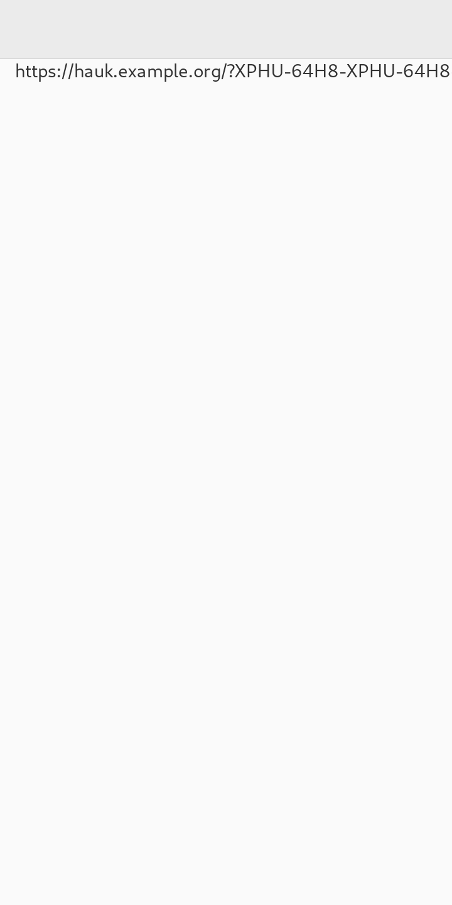
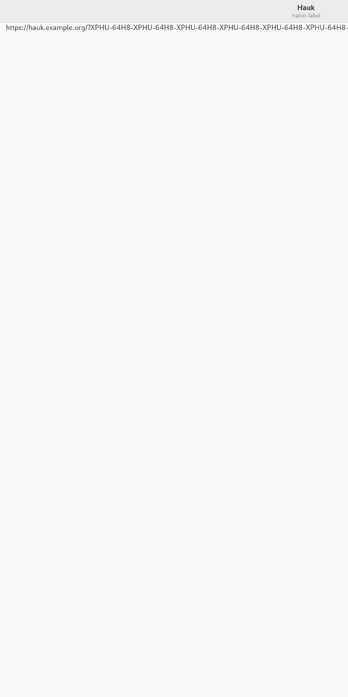
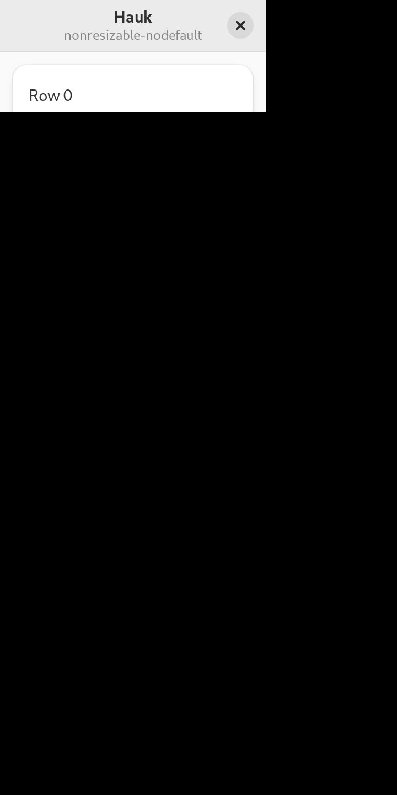
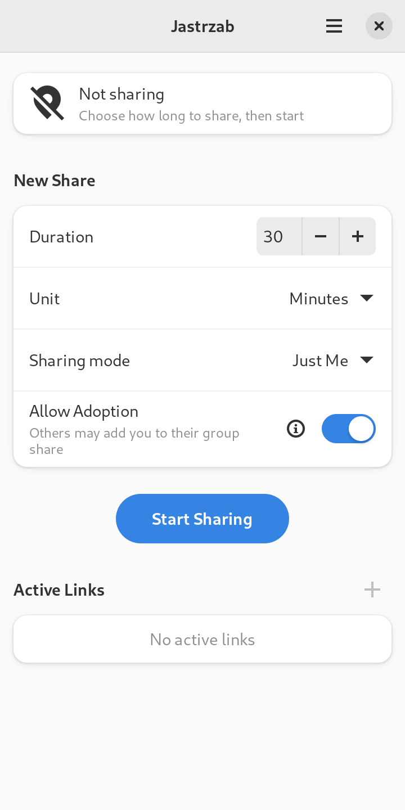
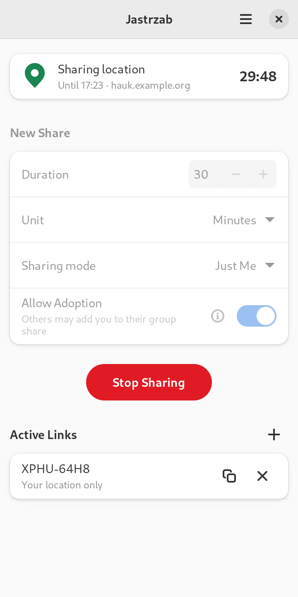
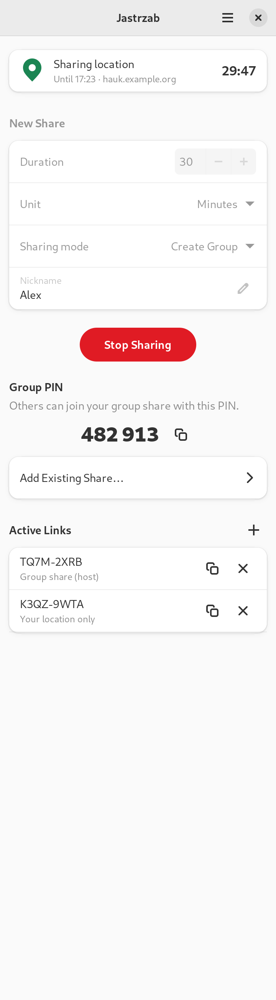
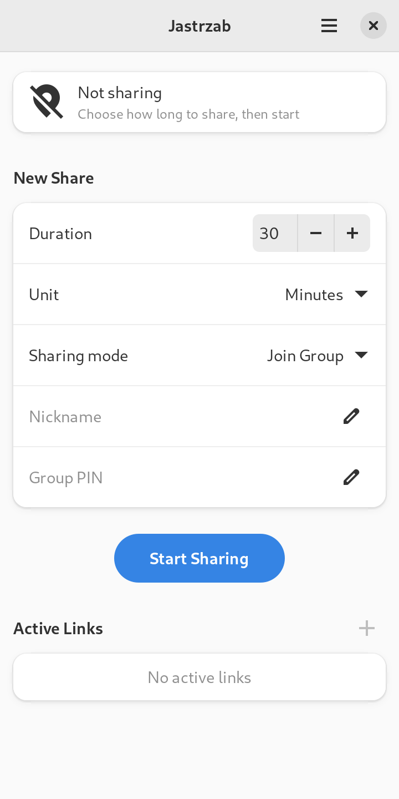
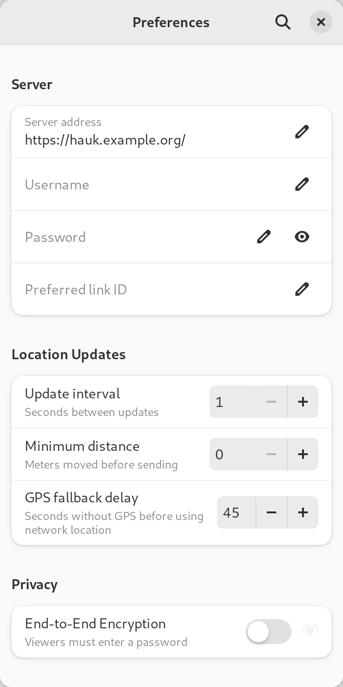
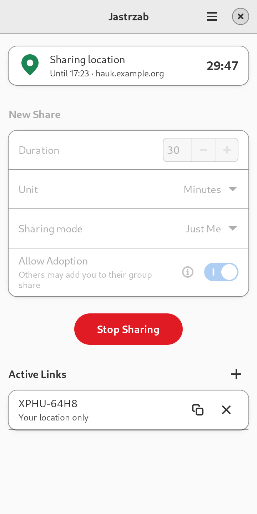

# Jastrzab — Phosh GUI design

Design for a Phosh-compatible, mobile-first GTK4 + libadwaita front end for **Jastrzab**, the Librem/Phosh clone of the Hauk location-sharing app. It builds on [`hauk-report.md`](hauk-report.md), which describes what the original does and how.

"Hauk" below means only the upstream Android app and the Hauk server and wire protocol that Jastrzab stays compatible with.

**Status.** The window-sizing findings in §2–3 were measured in a headless Phoc running in a PureOS Crimson chroot. The screen designs in §4 were built as a throwaway prototype on the same stack (Python and libadwaita 1.2.2) and screenshotted there. Nothing here has been run on a phone. §6 (Phosh integration) is research from the Phosh sources and is marked where unverified.

## 1. Platform baseline: PureOS Crimson

Versions come from the `Packages` indexes at `repo.pureos.net/pureos/dists/crimson{,-updates,-security}`, read on 2026-10-22.

| Component | Crimson version | Note |
|---|---|---|
| **libadwaita** | **1.2.2** | The hard cap. |
| **GTK 4** | **4.8.3** (`+deb12u1pureos2`) | |
| GLib | 2.74.6 | |
| Phosh / Phoc | 0.34.0 / 0.33.0 | |
| squeekboard | 1.22.0 | On-screen keyboard. |
| GeoClue | 2.7.0 | |
| libfeedback | 0.8.6 | |
| xdg-desktop-portal | 1.20.3 | `xdg-desktop-portal-gtk` is 1.14.1. |
| PyGObject (`python3-gi`) | 3.42.2 | |
| Vala | 0.56.3 | |
| blueprint-compiler | 0.6.0 | |
| rustc / cargo | 1.63 / 0.66 | Too old for current gtk-rs; Rust would need `rustup`. |
| adwaita-icon-theme | 43 | |

### What libadwaita 1.2 does not have

This is the widget set to design inside. Each "since" comes from the class docs in the libadwaita source.

| Not in 1.2 | Since | Use instead |
|---|---|---|
| `AdwBreakpoint`, `AdwNavigationView`, `AdwNavigationSplitView`, `AdwToolbarView` | 1.4 | One clamped, vertically scrolling column. `AdwLeaflet` and `AdwSqueezer` exist in 1.2 if a second page is needed. |
| `AdwSpinRow`, `AdwSwitchRow` | 1.4 | `AdwActionRow` with a `GtkSpinButton` or `GtkSwitch` suffix and `activatable-widget` set. |
| `AdwBanner` | 1.3 | A boxed-list row with an icon, text and a button. |
| `AdwAlertDialog`, `AdwDialog`, `AdwPreferencesDialog` | 1.5 | `AdwMessageDialog`, `AdwPreferencesWindow`. |
| `AdwSpinner`, `AdwButtonRow` | 1.6 | `GtkSpinner`; an `AdwActionRow` with `activatable`. |
| `GtkAccessible.announce()` | GTK 4.14 | Nothing. See §5. |

Available in 1.2 and used here: `AdwApplicationWindow`, `AdwHeaderBar`, `AdwToastOverlay`, `AdwClamp`, `AdwActionRow`, `AdwComboRow`, `AdwEntryRow` (1.2), `AdwPasswordEntryRow` (1.2), `AdwExpanderRow`, `AdwPreferencesWindow/Group/Page`, `AdwMessageDialog` (1.2), `AdwAboutWindow` (1.2), `AdwStatusPage`, `AdwWindowTitle`.

Style classes available in 1.2: `.boxed-list`, `.pill`, `.suggested-action`, `.destructive-action`, `.flat`, `.circular`, `.numeric`, `.dim-label`, `.title-1`…`.title-4`, `.success`, `.warning`, `.error`. `AdwStyleManager:high-contrast` exists (since 1.0).

### Implementation language

Python 3.11 with PyGObject 3.42, C, and Vala 0.56 all work as shipped. Rust is the odd one out because of rustc 1.63. Python is quickest for the prototype; the choice is left open in §8.

## 2. How a Phosh window gets its size

Phoc auto-maximizes toplevels by default, so a normal app fills the 360×720 (logical) screen. That does not stop an app growing, because GTK takes the **minimum** size from the widget tree and Phoc cannot make a window smaller than the minimum the app reports.

Measured in headless Phoc, 360×720 logical, Crimson's GTK 4.8.3 and libadwaita 1.2.2, window `default_size` 360×720. "Before" and "after" are before and after the content got longer:

| Case | Window before → after | |
|---|---|---|
| Plain `GtkLabel`, text becomes a 120-character URL | 360×720 → **1267×720** | grew |
| `GtkListBox` of 40 rows, not in a scroller | 360×720 → **360×2270** | grew |
| Three text buttons in a `GtkBox` | 360×720 → **534×720** | grew |
| Label with `wrap` + `WORD_CHAR` | 360×720 → 360×720 | held |
| Label with `ellipsize` | 360×720 → 360×720 | held |
| `AdwActionRow` with a very long subtitle | 360×720 → 360×720 | held |
| 40 rows in a vertical-only `ScrolledWindow` | 360×720 → 360×720 | held |

Failure screenshots:

-  An unwrapped label drives the window to 1267 px wide. The screen shows the left part of it.
-  With Phoc's `scale-to-fit` on, the oversized window is scaled down to fit the screen. Nothing is clipped, but the text is half size. It is a fallback, not a fix.
-  `set_resizable(False)` with no default size gives a 241×101 window that ignores maximize, leaving the rest of the screen black.

Reading the GTK 4.8.3 source (`gtk/gtkwindow.c`, `gtk_window_compute_default_size`), the requested size is `MAX(minimum, MIN(bounds, current_default))`, so a larger minimum always wins. `should_remember_size()` stores the size as the new default only when the window is resizable and not maximized, fullscreen or tiled. I did not re-measure the "never shrinks back" behaviour described in the project's field report; the rules below are written to avoid depending on it.

## 3. Window-size rules

These are the rules from the previous Librem app, each applied to Jastrzab. Where my measurements add something, it is noted.

### Width: nothing may widen the window past 360 px

1. **Cap the natural width of every label** with `max_width_chars=1`, and let it wrap or ellipsize. (Measured above: a plain label took the window to 1267 px.) In PyGObject: `label.set_max_width_chars(1)`.
2. **Server-controlled text is never short.** In Jastrzab that means:
   - link IDs and view URLs;
   - nicknames of group members;
   - server error text (the original shows the server's whole reply in a dialog);
   - the server URL in the status row.

   Use `wrap=True, wrap_mode=Pango.WrapMode.WORD_CHAR` for URLs and unbroken strings, or `ellipsize`.
3. **No `hexpand` plus an oversized `width_request`** to force a full-width row.
4. **`width_request` is only for touch targets** (44 px) and popovers (260 px), never to make content wider than a phone.
5. **Use `AdwClamp` for the content column** (`maximum_size=480`, `tightening_threshold=360`). It lets the column shrink, which is the reverse of a fixed width.
6. **Fixed rows of buttons must be designed to fit.** Jastrzab has none on the main screen. Per-link actions are two 44 px icon buttons in a row suffix. Three text buttons in a plain box measured 534 px, so use rows or a menu instead.
7. **Main content scrolls vertically only** (`hscrollbar_policy=NEVER`), so any width demand shows up in testing rather than hiding in a sideways scrollbar.

### Height: every screen must be able to get shorter than the phone

8. **Every full-window screen scrolls vertically.** In Jastrzab that is the main screen and any later full-page view. A 40-row list in a vertical scroller held the window at 720 px; the same list outside a scroller took it to 2270 px.
9. **If a `GtkStack` is ever added, check its homogeneity.** From the GTK documentation (not measured here), stacks are homogeneous by default, so the minimum height would be the tallest page even when it is hidden. Wrap each page in its own scroller, or set `vhomogeneous=False`. This design has one page and no stack.
10. **No widget forces a large minimum height.** Popover lists use `max_content_height`.

### Additional rules from this research

11. **Always set a default size of 360×720 and never call `set_resizable(False)`.** The non-resizable window above shrinks to its content and ignores maximize. A resizable window with a default size maximizes correctly.
12. **Present dialogs after the parent window is on screen, not in the same tick.** In the headless Phoc harness an `AdwMessageDialog` presented in the same main-loop iteration as its parent was reported mapped but did not appear in the screenshot ([`dialog-same-tick.png`](phosh-gui/sizing/dialog-same-tick.png)). Deferring with `GLib.idle_add()` or a short timeout showed it centred ([`dialog-deferred.png`](phosh-gui/sizing/dialog-deferred.png)). Presenting from a tick callback placed it at the top-left with the main window missing. This was only seen in headless Phoc, so confirm it on a real device before relying on the exact behaviour; the safe rule is to defer.
13. **Check landscape too:** 720×360 logical. The prototype scrolls instead of growing ([`idle-landscape.png`](phosh-gui/screens/idle-landscape.png)). The HIG's smallest size for phone apps is 360×294.

### Checklist for new UI

- New label with text you don't control: `max_width_chars(1)` plus `wrap` or `ellipsize`.
- New screen: a vertical `ScrolledWindow` around it, and add it to the "every screen fits a phone" check.
- Never `hexpand` plus `width_request` to stretch something across a box. A `width_request` must never exceed what fits in 360 px.
- New fixed row of buttons: add up widths, spacing and margins against 360 px, or use rows.
- New dialog: present it from an idle callback after the window has mapped.

## 4. Screens

All screenshots are the prototype running at 360×720 logical (720×1440 px at scale 2) in headless Phoc on Crimson's libadwaita 1.2.2. The prototype is in [`phosh-gui/prototype/jastrzab_spike.py`](phosh-gui/prototype/jastrzab_spike.py). It has no networking or location and is not the implementation.

### 4.1 Structure

```
AdwApplicationWindow         default size 360x720, resizable
└─ GtkBox (vertical)
   ├─ AdwHeaderBar           title "Jastrzab", end: Main Menu button
   └─ AdwToastOverlay
      └─ GtkScrolledWindow   hscroll NEVER, vexpand
         └─ AdwClamp         max 480, tightening 360
            └─ GtkBox (vertical, 24 px spacing, 12 px side margins)
               ├─ status row            (boxed list, one AdwActionRow)
               ├─ AdwPreferencesGroup "New Share"
               ├─ Start / Stop button   (pill)
               ├─ AdwPreferencesGroup "Group PIN"      (group host only)
               └─ AdwPreferencesGroup "Active Links"   (header suffix: New Link)
```

A single page replaces the Android layout's logo, tagline and repository link. The logo is dropped (it was 143 dp of vertical space, with a switch to hide it); branding moves to the About window.

### 4.2 Main screen

**Idle** — 

- Status row: icon, **Not sharing**, subtitle "Choose how long to share, then start".
- **New Share** group:
  - *Duration*: a spin button, default 30;
  - *Unit*: a combo (Minutes, Hours, Days);
  - *Sharing mode*: a combo (Just Me, Create Group, Join Group);
  - *Allow Adoption*: a switch with a help button, shown only for Just Me.
- **Start Sharing**: a `.pill` `.suggested-action` button, the only suggested-style button on the view.
- **Active Links**: empty placeholder "No active links", with a disabled New Link (+) button.

The duration range has to respect the server's limit. The Hauk backend rejects shares longer than `max_duration` (86400 s, 24 hours, by default) and shows an error. The prototype's range of 1–999 is a placeholder.

**Active** — 

- The status row shows a green pin, **Sharing location**, "Until 17:23 · server" and the remaining time as a `.numeric` `.title-4` label.
- The New Share group is insensitive while a session runs (the original disables the same fields).
- The primary button becomes **Stop Sharing** (`.destructive-action`, replacing `.suggested-action`).
- Each link is a row with its ID, a subtitle ("Your location only"), and Copy and Stop icon buttons.

**Group host** —  (shown on a tall display to fit the whole page)

- Adds a Nickname row and a **Group PIN** group (large `.numeric` PIN, a copy button, and an "Add Existing Share…" row with a `go-next-symbolic` arrow for adoption).

**Joining a group** —  shows Nickname and Group PIN entry rows.

### 4.3 Status states

State is carried by an icon and text. Colour is added on top and is never the only signal. Every icon below exists in Crimson's `adwaita-icon-theme` 43 (checked in the chroot). Only the Inactive and Active states were rendered in the prototype.

| State (Android status text) | Icon | Style class | Title |
|---|---|---|---|
| Inactive | `location-services-disabled-symbolic` | none | Not sharing |
| Connecting | `network-transmit-receive-symbolic` | none | Connecting… |
| Waiting for first fix | `find-location-symbolic` | `.warning` | Waiting for location fix |
| Coarse fix only | `find-location-symbolic` | `.warning` | Approximate location only |
| Active | `location-services-active-symbolic` | `.success` | Sharing location |
| Server unreachable | `network-offline-symbolic` | `.error` | Server unreachable |

"Connecting…" replaces the Android blocking progress dialog; the Start button is disabled and the form insensitive while it runs.

### 4.4 Dialogs and toasts

`AdwMessageDialog` is the only dialog type in libadwaita 1.2.

| Trigger | Heading | Responses |
|---|---|---|
| Tap Stop Sharing | Stop Sharing? — [`confirm.png`](phosh-gui/screens/confirm.png) | **Cancel** (default and close response), **Stop Sharing** (destructive) |
| "?" next to Allow Adoption | Share Adoption | Close |
| Add Existing Share… — [`adopt.png`](phosh-gui/screens/adopt.png) | Add Existing Share | Cancel, **Add** (suggested). Two entry rows (link or ID, nickname) as the extra child. |
| Server or network error | Connection Error (or the server's heading) | Close. The message label wraps with `WORD_CHAR`; the reply can be long. |
| Old server lacks group or E2E support | Server Is Out of Date | Close |

Esc activates the close response. Dialogs are for decisions and errors the user needs to act on. Everything else is a toast (`AdwToastOverlay`):

- "Sharing started" with a **Copy Link** button (this replaces the Android "Connection established / Share / OK" dialog);
- "Link copied", "PIN copied", "Link created".

**Resuming an unfinished session.** The original asks in a dialog at launch. The HIG says never to pop up a dialog unexpectedly, so the design shows a row at the top of the page instead: "Resume unfinished share?" with Resume and Dismiss buttons. This was not prototyped.

**Share sheet.** The Android system chooser has no counterpart in this design, so a link row offers **Copy** only. Whether a portal-based share action is worth adding is left to §8.

### 4.5 Preferences

`AdwPreferencesWindow` opened from the Main Menu (Ctrl+,). 

| Group | Rows |
|---|---|
| **Server** | Server address (URL input purpose), Username, Password (`AdwPasswordEntryRow`), Preferred link ID |
| **Location Updates** | Update interval (s), Minimum distance (m), GPS fallback delay (s): spin rows with a subtitle |
| **Privacy** | End-to-End Encryption: an expander row with an enable switch containing "Encryption password" |
| **Network** | Proxy (System Default, None, HTTP, SOCKS), proxy host and port (insensitive unless HTTP or SOCKS), Connection timeout (s), HTTPS certificate validation |
| **Behavior** | Confirm Before Stopping (switch) |

Changes apply immediately; no Save button (the HIG describes entry rows applying on Return or focus loss). Night mode and "hide logo" from the Android app are dropped: libadwaita follows the system colour scheme and there is no logo on the page. Secrets (password, encryption password) belong in the Secret Service keyring rather than a plain settings file.

Only the first four groups were drawn in the prototype; Network and Behavior are in the table above but not in the screenshot.

### 4.6 Menus and About

The **Main Menu** is a `GtkMenuButton` with `open-menu-symbolic` (accessible label and tooltip "Main Menu"), containing Preferences, Keyboard Shortcuts, About Jastrzab. The HIG says primary menus do not contain Close or Quit. **About** is an `AdwAboutWindow`, which must credit the upstream Hauk project (Apache-2.0).

### 4.7 Notification while sharing

The Android app shows an ongoing notification with **Copy link** and **Stop sharing** actions. On Phosh this would be a `GNotification` with two buttons; whether Phosh 0.34 renders those buttons on the lock screen and keeps the notification after it is tapped is the subject of §6.

### 4.8 Android → Jastrzab mapping

| Android | Jastrzab |
|---|---|
| Toolbar with gear | Header bar with Main Menu |
| Logo, tagline, repo link | Removed from the page; About window |
| Duration field + unit spinner | Duration spin row + Unit combo row |
| Mode spinner | Sharing mode combo row |
| "Allow adoption" checkbox + "(What's this?)" link | Switch row + help button |
| Status label (6 colours) | Status row with icon, text and style class |
| Button text `STOP SHARING [29:51]` | Stable button label; countdown in the status row |
| Connecting `ProgressDialog` | "Connecting…" status, form disabled |
| "Connection established" dialog | Toast with Copy Link |
| System chooser | Copy button and toast |
| `AlertDialog`s | `AdwMessageDialog` |
| Settings activity | `AdwPreferencesWindow` |
| Ongoing notification | `GNotification` (see §6) |

## 5. Accessibility

Sources are the GNOME HIG pages (accessibility, keyboard, pointer & touch, writing style, buttons, dialogs, toasts), the GTK 4.8.3 accessibility document, and the libadwaita 1.2.2 sources. The prototype's accessibility tree was **not** inspected with AT-SPI, so everything below is design intent, not a tested result.

**Names and labels**

- All interface elements need descriptive accessible names (HIG). Every icon-only button gets an explicit label with `update_property([Gtk.AccessibleProperty.LABEL], [text])`. In GTK 4.8 a tooltip is set as the accessible *description*, not the name, so a tooltip alone leaves the button nameless (`gtk_widget_set_tooltip_text` in 4.8.3 sets `GTK_ACCESSIBLE_PROPERTY_DESCRIPTION`). The prototype sets both.
- `AdwActionRow` sets `LABELLED_BY` and `DESCRIBED_BY` on its `activatable-widget` automatically (1.2.2 `adw-action-row.c`), so spin buttons and switches in rows need no manual relations. (PyGObject 3.42 cannot pass the widget list to `update_relation` anyway.)
- The primary button keeps a stable name, Start Sharing or Stop Sharing. The countdown is in a separate label so a screen reader does not re-read the button every second.

**Not colour alone**

- HIG: do not use colour as the only means of distinguishing information. §4.3 pairs each status colour with an icon and text. The destructive red button also changes its label.
- High contrast: libadwaita handles it for standard widgets.  Custom CSS, if any, goes in the `style-hc.css` resources.

**Text size and layout**

- Don't hard-code font sizes. The prototype at `text-scaling-factor=1.5` stays within the window and just wraps ([`idle-large.png`](phosh-gui/screens/idle-large.png)).
- `.numeric` (tabular figures) for the countdown and PIN, so the digits don't jitter.
- Dark mode is automatic ([`active-dark.png`](phosh-gui/screens/active-dark.png)).

**Keyboard and focus**

- Every action reachable by keyboard; logical focus order that follows reading order; Esc closes dialogs and Cancel is the default response of destructive confirmations; Ctrl+, opens Preferences; mnemonics (`_`) on dialog responses and menu items.
- Input purposes so squeekboard offers the right layout: URL for server address and adoption link, DIGITS for Group PIN, NAME for nickname, password rows for secrets. How squeekboard maps these is in §6.

**Touch targets**

- The HIG gives no pixel minimum: it says click targets should be "large enough to be comfortably used". This design adopts the 44 px minimum used by the earlier Librem app. The Copy, Stop and New Link icon buttons get a 44 px `width_request` and `height_request`, which is the legitimate use of `width_request` in rule 4. I did not measure the default size of libadwaita's flat icon buttons, so the prototype's buttons are not guaranteed to meet 44 px.

**Writing style (HIG)**

- Header capitalization for buttons, switch labels, menu items and headings ("Stop Sharing", "Allow Adoption", "Active Links").
- Sentence capitalization for field and combo labels ("Sharing mode", "Server address").
- No trailing periods in short labels, a real ellipsis (…) only where more input is needed ("Add Existing Share…"), not on "Preferences".

**Known gaps in the target stack**

- GTK 4.8 has no live-region or announce API (`gtk_accessible_announce` is 4.14). Toasts in libadwaita 1.2.2 are not announced. State changes that matter, such as the share ending or the connection dropping, therefore need to be visible in the status row (which a screen reader user can reach) and not only in a toast.
- Reduced motion: libadwaita animations stop when `gtk-enable-animations` is off. The countdown is text, not an animation.

## 6. Phosh integration

*Pending: the research on the Phosh sources is still running and will be merged here. It covers the app-grid compatibility keys, Phoc's maximize and scale-to-fit settings, squeekboard's keyboard-resizing and layout choice, notifications, suspend and background behaviour, location access, and Purism's guidance for app developers.*

## 7. Verifying the design

An Xvfb test cannot reproduce Phosh's window behaviour. The earlier Librem app found that it could only check the cause of overflow, not the overflow. A headless Phoc can measure the real surface size, so the rules in §3 can be asserted directly.

**Recipe (what produced the numbers above).** All of it is in [`phosh-gui/prototype/`](phosh-gui/prototype/).

1. Build a Crimson rootfs: `debootstrap --variant=minbase crimson <dir> https://repo.pureos.net/pureos/` with the `pureos-archive-keyring` key. Add `python3-gi gir1.2-adw-1 phoc grim fonts-cantarell adwaita-icon-theme dbus gsettings-desktop-schemas`.
2. Mount `/proc`, `/dev` and a tmpfs on `/dev/shm`, then `glib-compile-schemas` (the Phoc schema is installed with the package).
3. [`run_in_phoc.sh`](phosh-gui/prototype/run_in_phoc.sh) starts `phoc` with `WLR_BACKENDS=headless`, a 720×1440 output at scale 2 (360×720 logical), runs the app inside it, and takes a `grim` screenshot.
4. [`sizetest.py`](phosh-gui/prototype/sizetest.py) prints window allocation, surface size and the measured minimum size before and after growing the content.

**Suggested automated assertions for the real app**

- At 360 px wide, every screen in its worst case (long server URL, long error, many links, group with long nicknames) has a minimum width ≤ 360 px. For height, the earlier Librem app required ≤ 600 px; the HIG's phone minimum is 360×294, which is the stricter target to aim for. I did not measure the prototype's minimum height, so the achievable figure is unknown.
- The surface does not change size when the content grows.
- Every group header and label that shows server text has `max_width_chars == 1`.
- Landscape (720×360) and text scaling 1.5 pass the same checks.
- The AT-SPI tree has no unnamed buttons, switches, spin buttons or entries (not run on the prototype).

## 8. Open decisions

1. **Language.** Python (fastest, shipped in Crimson), C, or Vala. Rust only with `rustup`.
2. **App ID** (reverse DNS) and the app icon. The prototype uses the placeholder `org.example.Jastrzab`.
3. **Branding.** The Android app's big logo is dropped; the About window and icon need replacement art.
4. **Keyboard Shortcuts and Help.** The HIG lists them as standard primary-menu items; for an app this size a shortcuts window may not earn its place.
5. **Sharing the link beyond Copy.** Whether to add a portal-based share action (see §6).
6. **Group shares and adoption** are the most complex part of the original UI. If the first release is solo-only, the Sharing mode row, Nickname, Group PIN and adoption rows can be left out without changing the rest of the layout.
