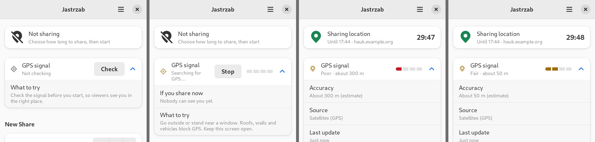
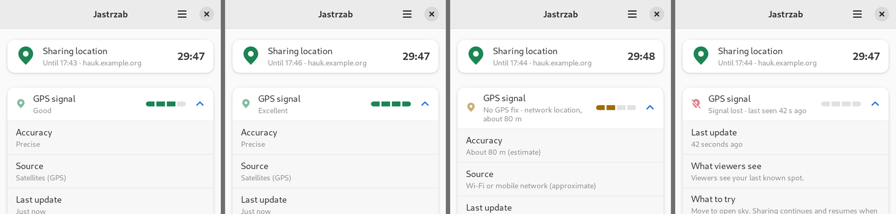

# Jastrzab — Phosh GUI design

Design for a Phosh-compatible, mobile-first GTK4 + libadwaita front end for **Jastrzab**, the Librem/Phosh clone of the Hauk location-sharing app. It builds on [`hauk-report.md`](hauk-report.md), which describes what the original does and how.

"Hauk" below means only the upstream Android app and the Hauk server and wire protocol that Jastrzab stays compatible with.

Jastrzab adds one feature the original does not have: a **GPS signal indicator** that says whether the phone has a fix, how good it is, and what that means for the people watching (§4.4).

**Status.** The window-sizing findings in §2–3 were measured in a headless Phoc running in a PureOS Crimson chroot. The screen designs in §4 were first built as a throwaway Python prototype on the same stack and screenshotted there. **The design is now implemented in Rust** (see the repository's [README](../README.md)), and the implementation was run in the same headless Phoc and checked through its accessibility tree, against a real Hauk backend and the real GeoClue 2.7.0; §7 lists what was measured. Nothing has been run on a phone. §6 (Phosh integration) is research from the Phosh, Phoc, squeekboard, GeoClue and xdg-desktop-portal sources at the Crimson versions, and is marked where unverified.

## 1. Platform baseline: PureOS Crimson

Versions come from the `Packages` indexes at `repo.pureos.net/pureos/dists/crimson{,-updates,-security}`, read on 2026-10-22.

| Component | Crimson version | Note |
|---|---|---|
| **libadwaita** | **1.2.2** | The hard cap. |
| **GTK 4** | **4.8.3** (`+deb12u1pureos2`) | |
| GLib | 2.74.6 | |
| Phosh / Phoc | 0.34.0 / 0.33.0 | |
| squeekboard | 1.22.0 | On-screen keyboard. |
| GeoClue | 2.7.0 | |
| libfeedback | 0.8.6 | |
| xdg-desktop-portal | 1.20.3 | `xdg-desktop-portal-gtk` is 1.14.1. |
| PyGObject (`python3-gi`) | 3.42.2 | |
| Vala | 0.56.3 | |
| blueprint-compiler | 0.6.0 | |
| rustc / cargo | 1.63 / 0.66 | Too old for current gtk-rs. The implementation uses rustup stable (needs 1.92+). `crimson-security` also carries `rustc-web` 1.96, which would do, but the release workflow uses rustup like the author's other app. |
| adwaita-icon-theme | 43 | |

### What libadwaita 1.2 does not have

This is the widget set to design inside. Each "since" comes from the class docs in the libadwaita source.

| Not in 1.2 | Since | Use instead |
|---|---|---|
| `AdwBreakpoint`, `AdwNavigationView`, `AdwNavigationSplitView`, `AdwToolbarView` | 1.4 | One clamped, vertically scrolling column. `AdwLeaflet` and `AdwSqueezer` exist in 1.2 if a second page is needed. |
| `AdwSpinRow`, `AdwSwitchRow` | 1.4 | `AdwActionRow` with a `GtkSpinButton` or `GtkSwitch` suffix and `activatable-widget` set. |
| `AdwBanner` | 1.3 | A boxed-list row with an icon, text and a button. |
| `AdwAlertDialog`, `AdwDialog`, `AdwPreferencesDialog` | 1.5 | `AdwMessageDialog`, `AdwPreferencesWindow`. |
| `AdwSpinner`, `AdwButtonRow` | 1.6 | `GtkSpinner`; an `AdwActionRow` with `activatable`. |
| `GtkAccessible.announce()` | GTK 4.14 | Nothing. See §5. |

Available in 1.2 and used here: `AdwApplicationWindow`, `AdwHeaderBar`, `AdwToastOverlay`, `AdwClamp`, `AdwActionRow`, `AdwComboRow`, `AdwEntryRow` (1.2), `AdwPasswordEntryRow` (1.2), `AdwExpanderRow`, `AdwPreferencesWindow/Group/Page`, `AdwMessageDialog` (1.2), `AdwAboutWindow` (1.2), `AdwStatusPage`, `AdwWindowTitle`.

Style classes available in 1.2: `.boxed-list`, `.pill`, `.suggested-action`, `.destructive-action`, `.flat`, `.circular`, `.numeric`, `.dim-label`, `.title-1`…`.title-4`, `.success`, `.warning`, `.error`. `AdwStyleManager:high-contrast` exists (since 1.0).

### Implementation language

**Rust**, with gtk4-rs 0.11 and libadwaita-rs 0.9 capped at Crimson by the crate features `gnome_43` (GTK 4.8) and `v1_2` (libadwaita 1.2), so the build fails if newer API is used. The two toolkit-free layers (`hauk`, `jastrzab-core`) are plain Rust and are tested without a display. Python 3.11 with PyGObject 3.42, C and Vala 0.56 would also have worked as shipped.

## 2. How a Phosh window gets its size

Phoc auto-maximizes toplevels by default, so a normal app fills the 360×720 (logical) screen. That does not stop an app growing, because GTK takes the **minimum** size from the widget tree and Phoc cannot make a window smaller than the minimum the app reports.

Measured in headless Phoc, 360×720 logical, Crimson's GTK 4.8.3 and libadwaita 1.2.2, window `default_size` 360×720. The harness has no Phosh top and bottom bars, so the screen is taller than a real phone's app area (see rule 13). "Before" and "after" are before and after the content got longer:

| Case | Window before → after | |
|---|---|---|
| Plain `GtkLabel`, text becomes a 120-character URL | 360×720 → **1267×720** | grew |
| `GtkListBox` of 40 rows, not in a scroller | 360×720 → **360×2270** | grew |
| Three text buttons in a `GtkBox` | 360×720 → **534×720** | grew |
| Label with `wrap` + `WORD_CHAR` | 360×720 → 360×720 | held |
| Label with `ellipsize` | 360×720 → 360×720 | held |
| `AdwActionRow` with a very long subtitle | 360×720 → 360×720 | held |
| 40 rows in a vertical-only `ScrolledWindow` | 360×720 → 360×720 | held |

Failure screenshots:

-  An unwrapped label drives the window to 1267 px wide. The screen shows the left part of it.
-  With Phoc's `scale-to-fit` on, the oversized window is scaled down to fit the screen. Nothing is clipped, but the text is half size. It is a fallback, not a fix.
-  `set_resizable(False)` with no default size gives a 241×101 window that ignores maximize, leaving the rest of the screen black.

Reading the GTK 4.8.3 source (`gtk/gtkwindow.c`, `gtk_window_compute_default_size`), the requested size is `MAX(minimum, MIN(bounds, current_default))`, so a larger minimum always wins. `should_remember_size()` stores the size as the new default only when the window is resizable and not maximized, fullscreen or tiled. I did not re-measure the "never shrinks back" behaviour described in the project's field report; the rules below are written to avoid depending on it.

## 3. Window-size rules

These are the rules from the previous Librem app, each applied to Jastrzab. Where my measurements add something, it is noted.

### Width: nothing may widen the window past 360 px

1. **Cap the natural width of every label** with `max_width_chars=1`, and let it wrap or ellipsize. (Measured above: a plain label took the window to 1267 px.) In PyGObject: `label.set_max_width_chars(1)`.
2. **Server-controlled text is never short.** In Jastrzab that means:
   - link IDs and view URLs;
   - nicknames of group members;
   - server error text (the original shows the server's whole reply in a dialog);
   - the server URL in the status row.

   Use `wrap=True, wrap_mode=Pango.WrapMode.WORD_CHAR` for URLs and unbroken strings, or `ellipsize`.
3. **No `hexpand` plus an oversized `width_request`** to force a full-width row.
4. **`width_request` is only for touch targets** (44 px) and popovers (260 px), never to make content wider than a phone.
5. **Use `AdwClamp` for the content column** (`maximum_size=480`, `tightening_threshold=360`). It lets the column shrink, which is the reverse of a fixed width.
6. **Fixed rows of buttons must be designed to fit.** Jastrzab has none on the main screen. Per-link actions are two 44 px icon buttons in a row suffix. Three text buttons in a plain box measured 534 px, so use rows or a menu instead.
7. **Main content scrolls vertically only** (`hscrollbar_policy=NEVER`), so any width demand shows up in testing rather than hiding in a sideways scrollbar.

### Height: every screen must be able to get shorter than the phone

8. **Every full-window screen scrolls vertically.** In Jastrzab that is the main screen and any later full-page view. A 40-row list in a vertical scroller held the window at 720 px; the same list outside a scroller took it to 2270 px.
9. **If a `GtkStack` is ever added, check its homogeneity.** From the GTK documentation (not measured here), stacks are homogeneous by default, so the minimum height would be the tallest page even when it is hidden. Wrap each page in its own scroller, or set `vhomogeneous=False`. This design has one page and no stack.
10. **No widget forces a large minimum height.** Popover lists use `max_content_height`.

### Additional rules from this research

11. **Always set a default size (360×648, the portrait area Phosh leaves the app, see rule 13) and never call `set_resizable(False)`.** The non-resizable window above shrinks to its content and ignores maximize. A resizable window with a default size maximizes correctly.
12. **Present dialogs after the parent window is on screen, not in the same tick.** In the headless Phoc harness an `AdwMessageDialog` presented in the same main-loop iteration as its parent was reported mapped but did not appear in the screenshot ([`dialog-same-tick.png`](phosh-gui/sizing/dialog-same-tick.png)). Deferring with `GLib.idle_add()` or a short timeout showed it centred ([`dialog-deferred.png`](phosh-gui/sizing/dialog-deferred.png)). Presenting from a tick callback placed it at the top-left with the main window missing. This was only seen in headless Phoc, so confirm it on a real device before relying on the exact behaviour; the safe rule is to defer.
13. **Design for the area the shell leaves, in both orientations.** Purism's design constraints (`Apps/Guides/Design/Constraints.rst` in the Librem 5 developer docs) give a 720×1440 screen at scale 2, so 360×720 points, minus a 26 px top bar and a 40 px bottom bar: **360×648 in portrait and 720×288 in landscape**. They say to "either make it fit a 360×288 pixels window so it automatically fits both or make your UI adapt to both sizes independently". Those figures are written for the Librem 5 and the bar heights have since changed, so treat 360×288 as the working target and confirm on a device. The HIG's phone minimum is 360×294, so 288 is the stricter of the two. The prototype scrolls instead of growing in landscape ([`idle-landscape.png`](phosh-gui/screens/idle-landscape.png)), though that capture is 720×360, not 720×288.

### Checklist for new UI

- New label with text you don't control: `max_width_chars(1)` plus `wrap` or `ellipsize`.
- New screen: a vertical `ScrolledWindow` around it, and add it to the "every screen fits a phone" check.
- Never `hexpand` plus `width_request` to stretch something across a box. A `width_request` must never exceed what fits in 360 px.
- New fixed row of buttons: add up widths, spacing and margins against 360 px, or use rows.
- New dialog: present it from an idle callback after the window has mapped.

## 4. Screens

All screenshots are the prototype running at 360×720 logical (720×1440 px at scale 2) in headless Phoc on Crimson's libadwaita 1.2.2. The prototype is in [`phosh-gui/prototype/jastrzab_spike.py`](phosh-gui/prototype/jastrzab_spike.py). It has no networking or location and is not the implementation.

### 4.1 Structure

```
AdwApplicationWindow         default size 360x720, resizable
└─ GtkBox (vertical)
   ├─ AdwHeaderBar           title "Jastrzab", end: Main Menu button
   └─ AdwToastOverlay
      └─ GtkScrolledWindow   hscroll NEVER, vexpand
         └─ AdwClamp         max 480, tightening 360
            └─ GtkBox (vertical, 24 px spacing, 12 px side margins)
               ├─ status row            (boxed list, one AdwActionRow)
               ├─ AdwPreferencesGroup (one AdwExpanderRow: "GPS signal", §4.4)
               ├─ AdwPreferencesGroup "New Share"
               ├─ Start / Stop button   (pill)
               ├─ AdwPreferencesGroup "Group PIN"      (group host only)
               └─ AdwPreferencesGroup "Active Links"   (header suffix: New Link)
```

A single page replaces the Android layout's logo, tagline and repository link. The logo is dropped (it was 143 dp of vertical space, with a switch to hide it); branding moves to the About window.

### 4.2 Main screen

**Idle** — 

- Status row: icon, **Not sharing**, subtitle "Choose how long to share, then start".
- **GPS signal** row: "Not checking" with a **Check** button (§4.4).
- **New Share** group:
  - *Duration*: a spin button, default 30;
  - *Unit*: a combo (Minutes, Hours, Days);
  - *Sharing mode*: a combo (Just Me, Create Group, Join Group);
  - *Allow Adoption*: a switch with a help button, shown only for Just Me.
- **Start Sharing**: a `.pill` `.suggested-action` button, the only suggested-style button on the view.
- **Active Links**: empty placeholder "No active links", with a disabled New Link (+) button.

The duration range has to respect the server's limit. The Hauk backend rejects shares longer than `max_duration` (86400 s, 24 hours, by default) and shows an error. The prototype's range of 1–999 is a placeholder.

**Active** — 

- The status row shows a green pin, **Sharing location**, "Until 17:23 · server" and the remaining time as a `.numeric` `.title-4` label.
- The **GPS signal** row is live for the whole session. It starts at **Searching** and then shows the current level and bar; it is never "Not checking" while sharing (§4.4).
- The New Share group is insensitive while a session runs (the original disables the same fields).
- The primary button becomes **Stop Sharing** (`.destructive-action`, replacing `.suggested-action`).
- Each link is a row with its ID, a subtitle ("Your location only"), and Copy and Stop icon buttons.

**Group host** —  (shown on a tall display to fit the whole page)

- Adds a Nickname row and a **Group PIN** group (large `.numeric` PIN, a copy button, and an "Add Existing Share…" row with a `go-next-symbolic` arrow for adoption).

**Joining a group** —  shows Nickname and Group PIN entry rows.

### 4.3 Status states

State is carried by an icon and text. Colour is added on top and is never the only signal. Every icon below exists in Crimson's `adwaita-icon-theme` 43 (checked in the chroot). Only the Inactive and Active states were rendered in the prototype.

| State (Android status text) | Icon | Style class | Title |
|---|---|---|---|
| Inactive | `location-services-disabled-symbolic` | none | Not sharing |
| Connecting | `network-transmit-receive-symbolic` | none | Connecting… |
| Active | `location-services-active-symbolic` | `.success` | Sharing location |
| Server unreachable | `network-offline-symbolic` | `.error` | Server unreachable |

"Connecting…" replaces the Android blocking progress dialog; the Start button is disabled and the form insensitive while it runs.

This row is about the **session** (server and timer) only. The Android app's "waiting for initial GNSS fix", "waiting for high accuracy fix" and "searching for location" states describe the *position*, so they moved to the GPS signal row (§4.4).

### 4.4 GPS signal indicator

This is new; the original shows only a text status ("Waiting for initial GNSS fix…", "Location sharing active!"). The row tells the user whether the phone has a position fix, how good it is, and what that means for the people following them.

**What the platform can tell us.** This decides the design, so it comes first.

- GeoClue 2.7's `org.freedesktop.GeoClue2.Location` object has Latitude, Longitude, Accuracy (metres), Altitude, Speed, Heading, Description and Timestamp. It has **no fix type, no signal strength and no satellite count**.
- For GPS fixes, `Accuracy` is not a measured error. `gclue_location_create_from_gga()` turns the NMEA GGA sentence's HDOP into a metre figure with `get_accuracy_from_hdop()` (`src/gclue-location.c`, GeoClue 2.7.0):

  | HDOP | ≤ 1 | ≤ 2 | ≤ 5 | ≤ 10 | ≤ 20 | > 20 |
  |---|---|---|---|---|---|---|
  | `Accuracy` reported | 0 m | 1 m | 3 m | 50 m | 100 m | 300 m |

  The code comment says "These are really just rough estimates". The `Description` of such a fix is `"GPS GGA"` (or `"GPS RMC"`). `Accuracy` is -1 when unknown.
- GeoClue's NMEA source keeps only GGA and RMC sentences and logs "Ignoring NMEA sentence" for everything else (`src/gclue-nmea-source.c`), so satellites-in-view data never reaches D-Bus.
- On Crimson the `gnss-share` 0.8.2 package (`0.8.2-1+pureos1~cri1`, arm64) feeds GeoClue. It installs `/etc/geoclue/conf.d/10-gnss-share.conf` (network-nmea enabled with `nmea-socket=/var/run/gnss-share.sock`, modem-gps and static-source disabled) and `/etc/gnss-share.conf` (socket `/var/run/gnss-share.sock`, group `geoclue`, driver `stm`, device `/dev/gnss0`). `gnss-share` sets the socket to mode 0660. An ordinary app therefore **cannot read the raw NMEA stream**, and satellite counts would mean adding the user to the `geoclue` group or running a privileged helper. That is the packaged default; another Crimson device may configure it differently.

So the indicator uses what GeoClue does give: accuracy, a source hint and the age of the last fix. **Satellite counts are left out on purpose.** A count answers "how many satellites?", not "will my friends see me in the right place?", and a normal app cannot get it here anyway.

**Layout.** One `AdwExpanderRow` titled "GPS signal", in its own group between the status row and "New Share". Collapsed it shows an icon, a one-line summary ("Good", "Fair · about 50 m") and a four-segment bar. Expanded it adds *Accuracy*, *Source*, *Last update*, *What viewers see* (or *If you share now* before sharing starts) and *What to try*. Two libadwaita 1.2 details:

- `AdwExpanderRow` has `add_action()` for its end widgets; `add_suffix()` arrived later.
- The bar is a discrete `GtkLevelBar`. libadwaita 1.2.2 gives each segment `min-width: 26px`, which makes a four-segment bar at least 110 px wide, so the app CSS sets 14 px. Its colour comes from app CSS classes using libadwaita's `@error_color`, `@warning_color` and `@success_color`, because the stock `low`/`high`/`full` offsets colour it blue for the middle levels.

All the states, in order Off, Checking, Poor, Fair, then Good, Excellent, Network only, Lost:





Theme and text-size variants: [lost, dark](phosh-gui/signal/lost-dark.png), [good, high contrast](phosh-gui/signal/good-high-contrast.png), [poor, 1.5× text](phosh-gui/signal/poor-large-text.png).

**Levels.** The cut-offs sit on GeoClue's own buckets, so they cannot be finer than that.

| Level | Bars | Colour | GeoClue `Accuracy` | Usually | What viewers see | What to try |
|---|---|---|---|---|---|---|
| Excellent | 4 | green | ≤ 1 m | GPS, HDOP ≤ 2 | Viewers will see you in the right spot. | |
| Good | 3 | green | ≤ 5 m | GPS, HDOP ≤ 5 | Viewers will see you at the right building. | |
| Fair | 2 | amber | ≤ 100 m | GPS, HDOP 5–20; Wi-Fi | Viewers may see you on the wrong street. | A clearer view of the sky will improve this. |
| Poor | 1 | red | > 100 m or unknown | GPS, HDOP > 20; mobile network or IP | Viewers will only see your rough area. | Move to open sky and wait a moment for a better fix. |
| Searching | 0 | grey | no fix yet | | Nobody can see you yet. | Go outside or stand near a window. Roofs, walls and vehicles block GPS. Keep this screen open. |
| Signal lost | 0 | red icon | no update for a while | | Viewers see your last known spot. | Move to open sky. Sharing continues and resumes when a signal returns. |
| Off | – | – | not checking | | | Check the signal before you start, so viewers see you in the right place. |

The thresholds and the viewer sentences are proposals. They are hedged because the numbers underneath are rough, and they need calibrating on a device (open sky, indoors, between buildings) before release. The mapping is a pure function (`level_for()` in the prototype).

**How metres are shown.** Below 10 m GeoClue's number is a coarse HDOP bucket, not a measurement, so the row says **Precise** and shows no figure. From 10 m up it shows "About N m" (rounded to 5 m), and the expanded *Accuracy* row marks it "(estimate)". An unknown value shows "Unknown".

**Source.** *Source* reads "Satellites (GPS)" when `Description` starts with "GPS", and otherwise "Wi-Fi or mobile network (approximate)". In that case the summary also changes to "No GPS fix · network location, about 80 m", so it cannot be mistaken for a GPS fix. `Description` is documented only as "a human-readable description of the location", so treat this as a hint and fall back to "Source unknown" if it is empty. The same test sets the Hauk `prv` flag the server and web viewer use to draw red (live) or orange (rough) markers: `prv=0` for GPS, `prv=1` otherwise. GeoClue chooses its sources itself, so the Android app's "fall back to network location if GNSS is unavailable for N seconds" preference has no equivalent and is removed (§4.6).

**When it runs.**

- **While sharing:** always, tied to the session.
- **Before sharing:** only after the user taps **Check** (the button then reads **Stop**). It stops by itself when the window is hidden and after 5 minutes (proposed). An active GeoClue client keeps GPS powered and should light Phosh's location indicator in the top bar (§6.6, not yet confirmed on a device), so a check is not silent.
Which signal states can appear depends on the session:

| Session | Signal row can show |
|---|---|
| Not sharing | **Off** ("Not checking", with a **Check** button), or after **Check**: Searching, Poor, Fair, Good, Excellent, Lost (with a **Stop** button) |
| Sharing | Searching, Poor, Fair, Good, Excellent, Lost. **Never Off**, and no Check/Stop button |

- It never blocks **Start Sharing**. With no fix yet, sharing starts and viewers see the web viewer's "waiting for signal" page until the first location arrives, as in the original.

**Keeping it calm and honest.**

- Use the median of the last five accuracy values. A level improves after two consecutive fixes and degrades only after three seconds in the worse level (proposed), so the bar does not flicker between Good and Fair.
- **Signal lost** means no `LocationUpdated` for `max(3 × update interval, 10 s)` (proposed). This is the least certain rule: GeoClue emits only when a source produces a new location, and a stationary phone on a network source may not for a long time, so non-GPS sources may need a longer window. It needs an on-device test.
- **Do not set GeoClue's `DistanceThreshold`.** Per `org.freedesktop.GeoClue2.Client.xml` it suppresses `LocationUpdated` when the phone has not moved far enough, which a stationary user would see as "signal lost". Apply the "Minimum distance" preference in Jastrzab before posting to the server, as the Android app did for GPS. Use GeoClue's `TimeThreshold` for the update interval.

**Where else it shows.** The notification title mirrors it, as the Android notification title mirrors its status (§4.8). The first time the signal is lost while sharing, show one toast, "GPS signal lost". Accessibility details are in §5.

### 4.5 Dialogs and toasts

`AdwMessageDialog` is the only dialog type in libadwaita 1.2.

| Trigger | Heading | Responses |
|---|---|---|
| Tap Stop Sharing | Stop Sharing? — [`confirm.png`](phosh-gui/screens/confirm.png) | **Cancel** (default and close response), **Stop Sharing** (destructive) |
| "?" next to Allow Adoption | Share Adoption | Close |
| Add Existing Share… — [`adopt.png`](phosh-gui/screens/adopt.png) | Add Existing Share | Cancel, **Add** (suggested). Two entry rows (link or ID, nickname) as the extra child. |
| Server or network error | Connection Error (or the server's heading) | Close. The message label wraps with `WORD_CHAR`; the reply can be long. |
| Old server lacks group or E2E support | Server Is Out of Date | Close |

Esc activates the close response. Response labels have **no mnemonic underscores**: in libadwaita 1.2.2 a response button's accessible name becomes `_Cancel Cancel` (the raw label, then the content), which a screen reader would read literally, and mnemonics mean nothing on a touch screen. Dialogs are for decisions and errors the user needs to act on. Everything else is a toast (`AdwToastOverlay`):

- "Sharing started" with a **Copy Link** button (this replaces the Android "Connection established / Share / OK" dialog);
- "Link copied", "PIN copied", "Link created".

**Resuming an unfinished session.** The original asks in a dialog at launch. The HIG says never to pop up a dialog unexpectedly, so the design shows a row at the top of the page instead: "Resume unfinished share?" with Resume and Dismiss buttons. It is the first row of the page in the implementation.

**Share sheet.** The Android system chooser has no counterpart in this design, so a link row offers **Copy** only. A portal-based share action was left out (§8).

### 4.6 Preferences

`AdwPreferencesWindow` opened from the Main Menu (Ctrl+,). 

| Group | Rows |
|---|---|
| **Server** | Server address (URL input purpose), Username, Password (`AdwPasswordEntryRow`), Preferred link ID |
| **Location Updates** | Update interval (s), Minimum distance (m): spin rows with a subtitle |
| **Privacy** | End-to-End Encryption: an expander row with an enable switch containing "Encryption password" |
| **Network** | Proxy (System Default, None, HTTP, SOCKS), proxy host and port (insensitive unless HTTP or SOCKS), Connection timeout (s), HTTPS certificate validation |
| **Behavior** | Confirm Before Stopping (switch) |

Changes apply immediately; no Save button (the HIG describes entry rows applying on Return or focus loss). Night mode and "hide logo" from the Android app are dropped: libadwaita follows the system colour scheme and there is no logo on the page. Secrets (password, encryption password) belong in the Secret Service keyring rather than a plain settings file.

The screenshot shows Server, Location Updates and the top of Privacy. Network and Behavior are built in the prototype but are below the visible area.

**Removed from the Android settings:** "Fall back to network location if GNSS is unavailable for (seconds)", because GeoClue picks the sources (§4.4). "Signal lost" timing is derived from the update interval, not a preference.

### 4.7 Menus and About

The **Main Menu** is a `GtkMenuButton` with `open-menu-symbolic` (accessible label and tooltip "Main Menu"), containing Preferences, Keyboard Shortcuts, About Jastrzab. The HIG says primary menus do not contain Close or Quit. **About** is an `AdwAboutWindow`, which must credit the upstream Hauk project (Apache-2.0).

### 4.8 Notification while sharing

The Android app shows an ongoing notification whose title mirrors the status and which has **Copy link** and **Stop sharing** actions. On Phosh 0.34 (§6.4):

- Action buttons are supported. Tapping the notification body is the default action and reopens the app.
- The title follows the signal, for example "Sharing · GPS signal lost".
- It is sent with the `resident` hint so it stays after being tapped (Phosh closes non-resident notifications once actioned). GLib's `GNotification` cannot set `resident`, so the app calls `org.freedesktop.Notifications.Notify` directly and re-sends with `replaces_id` to update it.
- Phosh does not advertise a persistence capability, so the user can still dismiss it. The in-app rows stay the source of truth.
- **Stop Sharing** is the one action worth allowing on the lock screen (§6.4), since it protects the user's privacy. Copy Link is not.

### 4.9 Android → Jastrzab mapping

| Android | Jastrzab |
|---|---|
| Toolbar with gear | Header bar with Main Menu |
| Logo, tagline, repo link | Removed from the page; About window |
| Duration field + unit spinner | Duration spin row + Unit combo row |
| Mode spinner | Sharing mode combo row |
| "Allow adoption" checkbox + "(What's this?)" link | Switch row + help button |
| Status label (6 colours) | Status row for the session (§4.3) and a separate GPS signal row for position quality (§4.4) |
| "Waiting for initial GNSS fix…", "Waiting for high accuracy fix…", "Searching for location…" | GPS signal row: Searching, Fair or Poor, Signal lost |
| "Fall back to network location after N s" setting | Removed; GeoClue chooses the source |
| Button text `STOP SHARING [29:51]` | Stable button label; countdown in the status row |
| Connecting `ProgressDialog` | "Connecting…" status, form disabled |
| "Connection established" dialog | Toast with Copy Link |
| System chooser | Copy button and toast |
| `AlertDialog`s | `AdwMessageDialog` |
| Settings activity | `AdwPreferencesWindow` |
| Ongoing notification | Resident `org.freedesktop.Notifications` notification (§4.8) |

## 5. Accessibility

Sources are the GNOME HIG pages (accessibility, keyboard, pointer & touch, writing style, buttons, dialogs, toasts), the GTK 4.8.3 accessibility document, and the libadwaita 1.2.2 sources. The prototype's accessibility tree was **not** inspected with AT-SPI, so everything below is design intent, not a tested result.

**Names and labels**

- All interface elements need descriptive accessible names (HIG). Every icon-only button gets an explicit label with `update_property([Gtk.AccessibleProperty.LABEL], [text])`. In GTK 4.8 a tooltip is set as the accessible *description*, not the name, so a tooltip alone leaves the button nameless (`gtk_widget_set_tooltip_text` in 4.8.3 sets `GTK_ACCESSIBLE_PROPERTY_DESCRIPTION`). The prototype sets both.
- `AdwActionRow` sets `LABELLED_BY` and `DESCRIBED_BY` on its `activatable-widget` automatically (1.2.2 `adw-action-row.c`), so spin buttons and switches in rows need no manual relations. (PyGObject 3.42 cannot pass the widget list to `update_relation` anyway.)
- The primary button keeps a stable name, Start Sharing or Stop Sharing. The countdown is in a separate label so a screen reader does not re-read the button every second.

**The GPS signal row (§4.4)**

- The level bar is decorative and is hidden from assistive technology (`GTK_ACCESSIBLE_STATE_HIDDEN`). The meaning is in text: the title, the one-line summary ("Fair · about 50 m") and, when expanded, the detail rows.
- The row's accessible description is set to that summary and changes only when the level changes, not every second, so a screen reader is not chattering.
- No "updated N seconds ago" counter ticks in the collapsed row. *Last update* is a detail row and only shows an age when the signal is lost.
- GTK 4.8 has no live-region API, so a drop in signal will not be announced. That is why the one-off "GPS signal lost" toast is paired with the notification title and the row text, which a screen-reader user can reach.
- Colour, bar length, icon and words all carry the level. Any one of them is enough.

**Not colour alone**

- HIG: do not use colour as the only means of distinguishing information. §4.3 pairs each status colour with an icon and text. The destructive red button also changes its label.
- High contrast: libadwaita handles it for standard widgets.  Custom CSS, if any, goes in the `style-hc.css` resources.

**Text size and layout**

- Don't hard-code font sizes. The prototype at `text-scaling-factor=1.5` stays within the window and just wraps ([`idle-large.png`](phosh-gui/screens/idle-large.png)).
- `.numeric` (tabular figures) for the countdown and PIN, so the digits don't jitter.
- Dark mode is automatic ([`active-dark.png`](phosh-gui/screens/active-dark.png)).

**Keyboard and focus**

- Every action reachable by keyboard; logical focus order that follows reading order; Esc closes dialogs and Cancel is the default response of destructive confirmations; Ctrl+, opens Preferences; mnemonics (`_`) on dialog responses and menu items.
- Input purposes so squeekboard offers the right layout: URL for server address and adoption link, DIGITS for Group PIN, NAME for nickname, password rows for secrets. How squeekboard maps these is in §6.

**Touch targets**

- The HIG gives no pixel minimum: it says click targets should be "large enough to be comfortably used". This design adopts the 44 px minimum used by the earlier Librem app. The Copy, Stop and New Link icon buttons get a 44 px `width_request` and `height_request`, which is the legitimate use of `width_request` in rule 4. I did not measure the default size of libadwaita's flat icon buttons, so the prototype's buttons are not guaranteed to meet 44 px.

**Writing style (HIG)**

- Header capitalization for buttons, switch labels, menu items and headings ("Stop Sharing", "Allow Adoption", "Active Links").
- Sentence capitalization for field and combo labels ("Sharing mode", "Server address").
- No trailing periods in short labels, a real ellipsis (…) only where more input is needed ("Add Existing Share…"), not on "Preferences".

**Known gaps in the target stack**

- GTK 4.8 has no live-region or announce API (`gtk_accessible_announce` is 4.14). Toasts in libadwaita 1.2.2 are not announced. State changes that matter, such as the share ending or the connection dropping, therefore need to be visible in the status row (which a screen reader user can reach) and not only in a toast.
- Reduced motion: libadwaita animations stop when `gtk-enable-animations` is off. The countdown is text, not an animation.

## 6. Phosh integration

Sources: Phosh v0.34.0, Phoc v0.33.0, squeekboard v1.22.0, GeoClue 2.7.0, xdg-desktop-portal 1.20.3, phosh-mobile-settings v0.34.0 and the Purism developer docs, read at those tags. Paths are relative to each project. **UNVERIFIED** marks things I could not confirm from code and that need a device test.

### 6.1 Showing up in the app grid

- Phosh filters the app grid in `src/app-grid.c`, `filter_adaptive()`. The `app-filter-mode` setting defaults to `['adaptive']`, and filtering is only active when the shell is not docked (`src/shell.c` binds `filter-adaptive` to the inverse of the docked manager).
- An app passes if its `.desktop` file has `X-Purism-FormFactor` containing `mobile;` (case-insensitive, **the trailing semicolon matters**), or `X-KDE-FormFactor` containing `handset;`, or its ID is in the `force-adaptive` setting.
- **Put `X-Purism-FormFactor=Workstation;Mobile;` in the desktop file.** AppStream is not consulted in 0.34.0 (no `appstream` or `metainfo` references in `src/` or `plugins/`). `docs/app-dev.md` says the key "will be phased out" for AppStream metadata (Phosh MR 950), which is not in 0.34.0, so also ship good metainfo but do not rely on it yet.
- Other desktop-file keys from `docs/app-dev.md` and the code:
  - `X-Geoclue-Reason`: the text shown in the location permission prompt (`src/location-manager.c`).
  - `X-Phosh-Lockscreen-Actions`: which notification actions may show on the lock screen (§6.4).
  - `X-Phosh-UsesFeedback=true`: for apps that use libfeedback. Jastrzab does not need it.

### 6.2 Window sizing

- Phoc `auto-maximize` (schema `sm.puri.phoc`, default `true`) maximizes only toplevels **without a parent** (`src/xdg-surface.c`, `want_auto_maximize`: `surface->toplevel && !surface->toplevel->parent`). Dialogs with a `transient-for` parent are not maximized, which matches the dialog captures in §4.5.
- Phoc `scale-to-fit` (default `false`, globally and per app) scales a window larger than the screen. `view_update_scale()` clamps the scale to **0.5–1.0** and never scales up. The per-app schema is `sm.puri.phoc.application` at path `/sm/puri/phoc/application/<munged app id>/`, where the Wayland app ID has every character outside `[0-9a-zA-Z-]` replaced with `-` and is lowercased (`org.example.Jastrzab` becomes `org-example-jastrzab`). phosh-mobile-settings has a per-app switch for it (`pms/src/ms-scale-to-fit-row.c`).
- Do not rely on it. It is a user-side rescue that shrinks the whole window, as the screenshot in §2 shows. The app has to fit natively.
- Design target: 360×648 portrait and 720×288 landscape (rule 13, §3).

### 6.3 On-screen keyboard

- squeekboard is a layer-shell surface anchored to the bottom with an **exclusive zone equal to its height** (`src/panel.c`, `panel_manager_request_widget()` and `panel_manager_resize()`), so it takes space from the output's usable area rather than floating over the app. How Phoc then re-lays-out a maximized window is **UNVERIFIED**; my 360×440 capture ([`idle-osk.png`](phosh-gui/screens/idle-osk.png)) only shows that the page scrolls at that height.
- **Consequence:** the page is already a vertical scroller, so it works with a smaller window, and the focused entry has to stay reachable. Check on a device that GTK scrolls the focused row into view when the keyboard opens.
- Layout choice comes from the text-input content purpose (`src/data/loading.rs`, `get_directory_string()`): Email → email, Digits/Number/Phone → number, Pin → pin, Terminal → terminal, Url → url. **Everything else, including Name and Password, uses the default text layout.**
- So: server address and the adoption link use `URL` (url layout); Group PIN uses `DIGITS` (number layout), not `PIN`, because GTK 4.8.3 documents `PIN` as "Like `GTK_INPUT_PURPOSE_DIGITS`, but characters are hidden" (`gtk/gtkenums.h`) and the group PIN is meant to be read out and shared; nicknames use `NAME` (default layout). Password rows get the default layout with no special help.

### 6.4 Notifications

- `GetCapabilities` returns `body`, `body-markup`, `actions`, `icon-static` (`src/notifications/notify-manager.c`). No `persistence`, `sound` or `action-icons`.
- Actions are supported. The `default` action is the notification body and does not get a button.
- **Lock screen.** Shown only if the `show-in-lock-screen` setting is on. Action buttons are filtered by the app's `X-Phosh-Lockscreen-Actions` desktop key (`src/lockscreen.c`, `src/notifications/notification-content.c`). The format in `docs/app-dev.md` is `X-Phosh-Lockscreen-Actions=app.stop-alarm::;app.snooze-alarm::;`. If the key is absent the code reads as "use all actions", but that is **UNVERIFIED**; set the key explicitly to the stop action only. The default action while locked is postponed until unlock.
- **Hints.** `urgency` is honoured only when it is critical (no expiry, banner always shown), `transient` and `resident` are read as booleans. `invoke_action()` closes the notification after an action **unless it is resident**.
- **`GNotification` cannot send `resident`.** `glib/gfdonotificationbackend.c` says "GLib doesn't currently support the `resident` hint" (the GLib source copy I read has no version tag, so it may differ from Crimson's 2.74). Send the notification yourself with `org.freedesktop.Notifications.Notify` and `{"resident": true}`, and re-send with `replaces_id` to change the title.

### 6.5 Staying alive: closing the window, suspend

- **Closing.** Swiping an app away in the overview only asks its toplevel to close (`src/overview.c`, `on_activity_closed()` → `phosh_toplevel_close()` → `zwlr_foreign_toplevel_handle_v1_close`). It is not a kill. A `GApplication` exits when its last window closes unless it holds itself with `g_application_hold()` (general GLib behaviour, not verified in source here). Jastrzab must hold while a share is active.
- **Proposed behaviour.** Closing the window while sharing asks once, with an `AdwMessageDialog`: "Keep sharing?" with **Stop Sharing** and **Keep Sharing in Background** (suggested). It is a decision the user has just triggered, not an unexpected pop-up. Android keeps sharing in a foreground service after the activity closes; this is the closest equivalent. The notification (§4.8) is how the user returns or stops.
- **Suspend.** `GTK_APPLICATION_INHIBIT_SUSPEND` goes to `org.gnome.SessionManager.Inhibit`, falling back to the `org.freedesktop.portal.Inhibit` portal (`gtk/gtkapplication-dbus.c`). gnome-session turns a suspend inhibitor into a logind `sleep` "block" inhibitor (`gsm-systemd.c`). **Whether a gnome-session is running on PureOS is UNVERIFIED.** Phosh does not implement `SessionManager.Inhibit` itself but uses logind inhibitors directly (`src/suspend-manager.c`), so the dependable route is to take a logind sleep inhibitor yourself with `org.freedesktop.login1.Manager.Inhibit("sleep", …, "block")` while sharing.
- A sleep inhibitor does not stop the screen blanking or locking. Which component suspends the phone on idle, and whether inhibitors block a manual suspend from the power menu, are **UNVERIFIED**. Test: start a share, lock the phone, wait, and check the server keeps receiving fixes.
- The Background portal exists in xdg-desktop-portal 1.20.3 (`RequestBackground`, `SetStatus`), but whether the GTK backend (1.14.1) implements it is **UNVERIFIED**. A native package is not killed by Phosh in the background, so it is not needed.

### 6.6 Location

- **Use libgeoclue directly**, not the portal. It lets the app set its own `DesktopId` (required for authorization), `RequestedAccuracyLevel` (use `EXACT`, value 8), `TimeThreshold` (the update interval) and `DistanceThreshold` (leave at 0, §4.4).
- Phosh runs the GeoClue agent (`src/location-manager.c`): it sets the maximum accuracy from its `max-accuracy-level` setting when location services are on, or none when they are off, and shows the `X-Geoclue-Reason` text.
- Phosh's top bar has a location indicator (`PhoshLocationInfo`, icon `location-services-active-symbolic`, bound to the manager's `active` property). What drives `active` was not traced, so confirm that a GeoClue client from Jastrzab lights it.
- The `org.freedesktop.portal.Location` portal (version 1) works for unsandboxed apps (`xdp/src/location.c` grants `EXACT`) but adds a session and `Start` call, and whether `Start` accepts an empty parent window string is **UNVERIFIED**.
- Sources on Crimson: the packaged `gnss-share` config (§4.4) enables the NMEA socket and disables the modem GPS and static sources. GeoClue's `[wifi]`, `[3g]` and `[cdma]` sources are on in its stock config and use the Mozilla Location Service. The `/etc/geoclue/geoclue.conf` actually installed on Crimson was **not read**.

### 6.7 Guidance from Purism

- Screen: 720×1440 at scale 2, so 360×720 points, minus 26 px and 40 px shell bars (rule 13, §3).
- The Purism adaptive-UI guide in the clone I read covers GTK 3 and libhandy only. There is no libadwaita guidance there, and no AppStream form-factor requirements (**UNVERIFIED**; the only concrete requirement found is the desktop-file key in §6.1).

## 7. Verifying the design

An Xvfb test cannot reproduce Phosh's window behaviour. The earlier Librem app found that it could only check the cause of overflow, not the overflow. A headless Phoc can measure the real surface size, so the rules in §3 can be asserted directly.

**Recipe (what produced the numbers above).** All of it is in [`phosh-gui/prototype/`](phosh-gui/prototype/).

1. Build a Crimson rootfs: `debootstrap --variant=minbase crimson <dir> https://repo.pureos.net/pureos/` with the `pureos-archive-keyring` key. Add `python3-gi gir1.2-adw-1 phoc grim fonts-cantarell adwaita-icon-theme dbus gsettings-desktop-schemas`.
2. Mount `/proc`, `/dev` and a tmpfs on `/dev/shm`, then `glib-compile-schemas` (the Phoc schema is installed with the package).
3. [`run_in_phoc.sh`](phosh-gui/prototype/run_in_phoc.sh) starts `phoc` with `WLR_BACKENDS=headless`, a 720×1440 output at scale 2 (360×720 logical), runs the app inside it, and takes a `grim` screenshot.
4. [`sizetest.py`](phosh-gui/prototype/sizetest.py) prints window allocation, surface size and the measured minimum size before and after growing the content.

**Suggested automated assertions for the real app**

- At 360 px wide, every screen in its worst case (long server URL, long error, many links, group with long nicknames) has a minimum width ≤ 360 px. For height, the earlier Librem app required ≤ 600 px; the HIG's phone minimum is 360×294, which is the stricter target to aim for. I did not measure the prototype's minimum height, so the achievable figure is unknown.
- The surface does not change size when the content grows.
- Every group header and label that shows server text has `max_width_chars == 1`.
- Landscape (720×360) and text scaling 1.5 pass the same checks.
- The AT-SPI tree has no unnamed buttons, switches, spin buttons or entries (not run on the prototype).
- The signal row is never **Off** while a session is active, and a new session starts at **Searching** (the prototype enforces this in `set_signal()`).
- The GPS signal logic is pure and can be tested without a phone: feed `level_for()` and the debounce and lost-timer the GeoClue values `-1, 0, 1, 3, 50, 100, 300` and gaps in updates, and assert the level, bar count, summary text and accessible description for each of the eight states. Screenshot each state at 360×648, 720×288, 1.5× text, dark and high contrast.
- Replay a recorded GeoClue sequence on a real device (open sky, indoors, walking between buildings) to calibrate the thresholds in §4.4.

### Measured on the implementation

The Rust app (`app/`) was built against Crimson's own libraries (GTK 4.8.3, libadwaita 1.2.2, libsoup 3.2.3, libsecret 0.20.5, GLib 2.74.6) and run in the headless Phoc at 360×720 logical (720×1440 at scale 2) by the scripts in [`scripts/ui-e2e/`](../scripts/ui-e2e/README.md), which operate it through AT-SPI. The backend is a real Hauk 1.6.3 (PHP and Redis), the location source the real GeoClue 2.7.0 from Crimson, the keyring gnome-keyring; the notification server and logind are fakes that record what the app asks of them. Screenshots of the real app: [idle](phosh-gui/app/idle.png), [checking the signal](phosh-gui/app/checking.png), [sharing](phosh-gui/app/sharing.png), [hosting a group](phosh-gui/app/group.png), [the stop confirmation](phosh-gui/app/confirm-stop.png), [Preferences](phosh-gui/app/preferences.png), [GeoClue's network-source fix](phosh-gui/app/geoclue-check.png), [a 1000-character server message](phosh-gui/app/hostile-server.png), [25 long links](phosh-gui/app/hostile-links.png) and [the same at 1.5× text](phosh-gui/app/large-text.png).

| Check | Result |
|---|---|
| Window size with a hostile server (25 links with 80-character IDs, then a 1000-character server message) | Unchanged at 360×720. The status row shows at most 160 characters of a server message. |
| Smallest screen the window fits | It fits 720×288 (landscape after Phosh's bars, design rule 13) and 320×640, so its minimum size is at most 720×288 and at most 320×640. Also unchanged at 720×360 and with text at 1.5×. |
| Accessibility tree of the idle window | No unnamed interactive control, after fixing one: the GPS signal expander row had a description but no name. |
| Accessibility of Preferences | Every control has a name. |
| A solo share against the real backend | Check shows *Good* for a 3 m fix; sharing starts; the server receives `lat/lon/prv=0/acc/spd` and the fix's own timestamp, and later points keep arriving; Stop through the confirmation dialog ends it and the share is gone on the server. The GPS row never reads *Not checking* while sharing. |
| A group share | The group PIN is shown, the link row says *Group share (host)*, and the nickname reaches the server. |
| The real GeoClue | The static source's fix arrives (shown as "No GPS fix · network location, precise", because its `Description` is not `GPS…`) and is posted with `prv=1`. GeoClue holds every `GetClient` until the user's location agent has registered, so on a phone Phosh must be up; the test stands in GeoClue's demo agent. |
| Notification | Sent resident, with `default`, `copy-link` and `stop-sharing` actions and the desktop entry; replaced (same ID) when the title changes, not re-sent on every fix; its Stop action ends the share; withdrawn on stop. |
| Suspend inhibitor | A logind `sleep`/`block` lock is held while sharing and released when it ends. |
| Keyring | The password stored through libsecret reads back (Preferences shows it). |
| Log | One file per day named `jastrzab.YYYY-MM-DD`; nothing on disk for the first minute, flushed by the 60 s timer and on a clean exit; line format as in the README; the share ID, server address and group PIN are scrubbed and no coordinate or password appears. |
| Crash | `kill -SEGV` writes a Breakpad minidump (`MDMP`), the crash server logs its path into the same log file, and the lines buffered before the crash are on disk. |

Findings that changed the design on the way:

* AT-SPI shows `AdwMessageDialog` buttons named `_Cancel Cancel`; the response labels now have no mnemonic underscore (§4.5).
* `AdwExpanderRow` is a list item of its own and has to be given an accessible name.
* An AT-SPI client cannot activate libadwaita combo rows or activatable list rows, and a headless Phoc has no keyboard focus for key synthesis; the harness preselects the sharing mode through a debug-only environment variable.
* GeoClue's agent requirement, above.

**Still for a device:** the Phosh location prompt and whether the top-bar indicator lights while a client is active; suspend and the inhibitor with the screen locked; the lock-screen *Stop* action; the on-screen keyboard re-layout; aarch64 minidumps (`minidump-writer` marks aarch64 "untested"); and the thresholds, debounce and lost-signal windows in §4.4.

## 8. Decisions

Settled by the implementation:

1. **Language: Rust**, with the toolkit-free logic in two crates.
2. **App ID `io.github.gdr_aislop.jastrzab`** (the underscore because `flatpak-builder` rejects a hyphen in a non-final segment), binary and log prefix `jastrzab`. The app icon is a placeholder.
3. **Branding:** the Android logo is dropped; the About window credits Hauk (Apache-2.0).
4. **No Keyboard Shortcuts window.** The only shortcut is Ctrl+, for Preferences.
5. **Sharing the link: Copy only** (toast, link rows, notification action).
6. **Group shares and adoption are in the first release.**
7. **Closing the window while sharing asks once** ("Keep Sharing?", with *Keep Sharing*, *Stop Sharing* and *Cancel*); the share keeps running in the background and the notification brings the user back.
8. **`prv` comes from the GeoClue `Description`** (`GPS…` is fine, anything else coarse).
9. **Encryption is never silently dropped:** if the server is older than 1.5 the just-created session is ended and nothing is shared (the Android app carries on unencrypted). It is also refused for group shares.
10. **The default update interval is 5 s** (Hauk's is 1 s), because every post wakes the radio. A post carries the fix's own timestamp.

Still open:

* **GPS signal calibration.** The level thresholds, the debounce (2 fixes up, 3 s down), the lost-signal window (`max(3 × interval, 10 s)` for satellite fixes, `max(12 × interval, 120 s)` for network ones) and the 5-minute limit on *Check* are proposals to tune on a device.
* **Satellite details.** Left out because the NMEA socket is `0660 root:geoclue`. They would need `geoclue` group membership or a small privileged helper.
* **Final icon and screenshots for the metainfo.**
* **AppImage, Flatpak and a signed APT repository** (the author's other app has them); the release workflow builds and attaches `.deb`s only.
